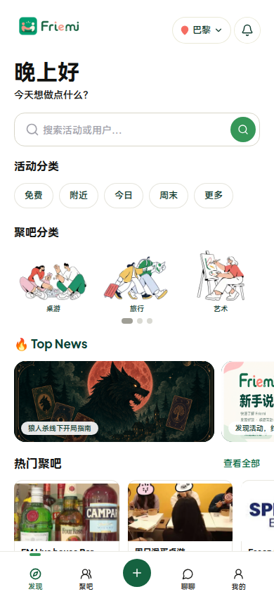
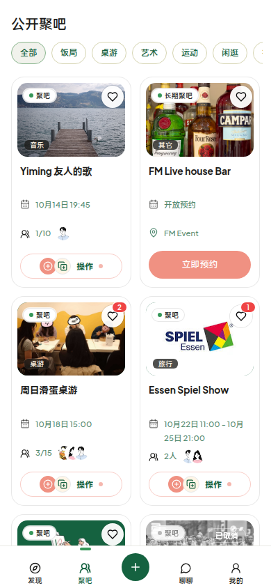
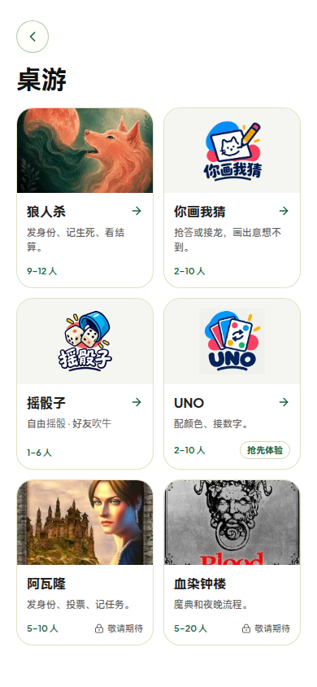
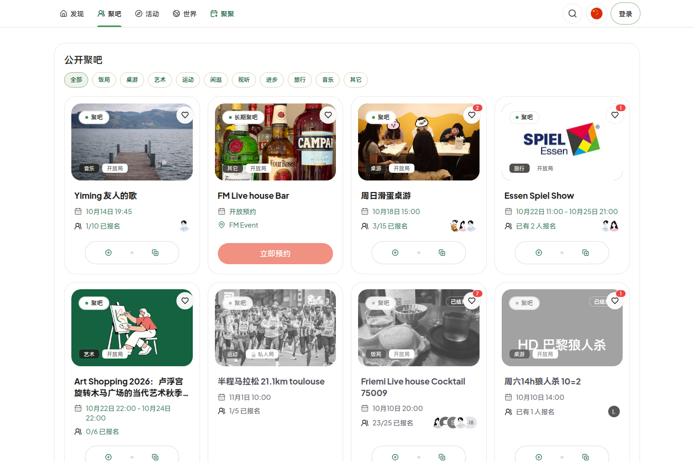

# Friemi

  <strong>发现城市里的好去处，约上合拍的人，让相聚继续。</strong>

  
  
  

  <a href="#产品实景">产品实景</a>
  ·
  <a href="#你可以在这里做什么">认识 Friemi</a>
  ·
  <a href="#桌游与在线游戏">一起玩</a>
  ·
  <a href="#体验入口">开始体验</a>

Friemi 帮你在城市里找到想做的事，也找到愿意一起去的人。

以巴黎为起点，面向海外生活场景，Friemi 将活动发现、聚吧、兴趣社群和日常互动连接起来。一场展览、一次饭局、一桌游戏，都可以成为认识新朋友、延续老朋友关系的开始。

支持 **简体中文、English 和 Français**，覆盖 Web、Android 与 iOS。

## 产品实景

### 移动端

发现城市灵感、找到同行聚吧、约朋友玩一局。

  
  
  

### 桌面网页

官网首页：了解 Friemi 与共创主理人的活动社群。

聚吧发现：在大屏上浏览同行计划与活动安排。

截图来自 Friemi 正式网站，拍摄于 2026 年 10 月 12 日。

## 你可以在这里做什么

### 发现：找到下一次出门的理由

周末还没安排？先看看城市里正在发生什么。展览、音乐、运动、桌游、吃饭、散步和旅行，通过主题分类、搜索与推荐找到感兴趣的内容。

查看时间、地点和活动信息，收藏想去的地方；遇到一场值得同行的活动，也可以从它发起聚吧，约上一起去的人。

### 聚吧：把“下次一起”变成一个计划

发起一场饭局、约人逛展，或者组织周末桌游。写下想做的事，约好时间地点，设置人数、费用和公开范围，就可以邀请大家加入。

发起人能管理报名、审核参与者、邀请共同管理员和发布公告。参与者在聚吧群聊里沟通，分享链接或二维码邀请朋友，用投票一起决定安排。

共同开支可以记在聚吧的**记账本**里：谁付了钱、哪些人分摊、过程中转过多少、最后各自应付或应收，都能一起核对，并跟进结算。实际转账由参与者自行完成。

### 星球：找到经常一起玩的那群人

一次活动之后，还想继续见面？加入一个围绕共同兴趣的星球，在社群里聊天、分享图文和视频、关注下一次聚吧。

星球把成员、日常分享与线下相聚放在一起，也提供邀请、加入审核和成员管理，让一个兴趣圈子可以持续经营。

### 世界与个人空间：记录相聚，也保持联系

在世界页发布图文足迹，记录一场展览、一顿饭或一次出行，通过点赞、评论和转发发现彼此的日常。

关注感兴趣的人，与互关的朋友保持联系，通过私聊继续交流。个人空间汇集你的聚吧、参与记录、收藏和成就；礼物互动与礼物墙，也让朋友之间的心意留下记录。

### 门店与背包：让线下体验更方便

门店可以通过长期聚吧提供预约入口，设置开放日期。用户选择日期和人数提交预约，由店主接受或拒绝，并在自己的预约记录中查看进展。

领取的优惠券和持有的票券可以在背包查看，票券按相应规则赠送或核销。商城提供朋友之间的礼物互动，背包则方便管理实际持有的券与票。

## 桌游与在线游戏

聚在一张桌旁，或者和远处的朋友约一局，Friemi 都有一起玩的方式。

| 游戏     | 一起怎么玩                                                                 |
| -------- | -------------------------------------------------------------------------- |
| 狼人杀   | 用手机查看身份、跟进主持流程、记录生死和查看复盘，现场继续发言、投票和推理 |
| 你画我猜 | 轮流画、抢着猜，也可以把词和画接龙传下去，看看最后变成什么                 |
| 摇骰子   | 自由摇骰、电脑练习，或邀请朋友进入 2–6 人吹牛房间                          |
| UNO      | 和朋友开一桌牌局，按颜色或数字出牌，体验经典积分或快速单局                 |

具体玩法与开放状态以[桌游页](https://www.friemi.com/zh-CN/game-tools)显示为准。

## 适合怎样的你

- **刚来到一座城市**：找周末安排，认识有共同兴趣的新朋友。
- **想约朋友出门**：把活动、报名、群聊、投票和共同开支放在同一个聚吧里。
- **经常组织活动**：管理参与者，通过星球保持社群联系，继续发起下一场相聚。
- **经营线下门店**：通过长期聚吧承接预约，用优惠券和票券连接线下体验。

## 在手机和电脑上使用

Friemi 围绕手机上的日常使用设计，也适配桌面浏览器。Web、Android 与 iOS 延续同一套活动、聚吧、社群与聊天体验，方便从看到活动到真正出门，再到活动之后继续联系。

公开页面可以直接浏览；报名、聊天与个人互动按页面提示登录。

## 体验入口

| 想做什么         | 从这里开始                                                                        |
| ---------------- | --------------------------------------------------------------------------------- |
| 了解 Friemi      | [官网](https://www.friemi.com/zh-CN/home)                                         |
| 下载 iOS App     | [App Store](https://apps.apple.com/fr/app/friemi/id6788944230)                    |
| 下载 Android App | [Google Play](https://play.google.com/store/apps/details?id=com.friemi.app&hl=en) |
| 找出门灵感       | [发现](https://www.friemi.com/zh-CN/mobile-home)                                  |
| 找搭子、发起计划 | [聚吧](https://www.friemi.com/zh-CN/lobby)                                        |
| 看城市公开活动   | [活动](https://www.friemi.com/zh-CN/activities)                                   |
| 加入兴趣社群     | [星球](https://www.friemi.com/zh-CN/planets)                                      |
| 看看大家的日常   | [世界](https://www.friemi.com/zh-CN/footprints)                                   |
| 和朋友玩一局     | [桌游](https://www.friemi.com/zh-CN/game-tools)                                   |

[中文](https://www.friemi.com/zh-CN/mobile-home) · [English](https://www.friemi.com/en/mobile-home) · [Français](https://www.friemi.com/fr/mobile-home)

打开 [Friemi](https://www.friemi.com)，选一个想去的活动，约上愿意一起出发的人。
