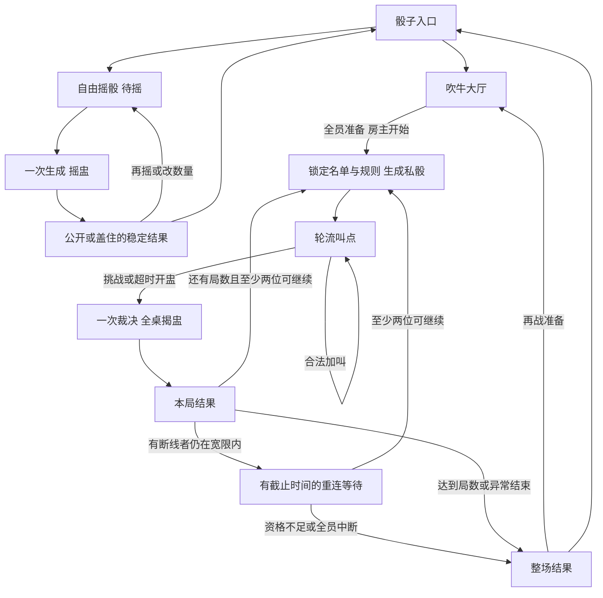

# Friemi 骰子游戏设计方案

版本：2026-10-11，第七次修订：继续修复动态偏好切换、盖盅期间旋转屏幕与窄屏大字号结算布局。供产品、视觉、前端与后端共同实施。首版采用「自由摇骰」与「多人吹牛」两个模式，共用骰盅、骰子、桌面和声音语言。以下人数、计时、计分与房规是本方案的首版设计默认值，尚未成为线上功能。

用户要得到的是一张随时可以开玩的游戏桌：拿起骰盅、摇动、等待、揭开、看到结果，再接着玩。骰子和玩家动作占据画面中心；配置只在需要时出现。成功标准是首次进入即可找到开玩动作，静音或关闭动效仍能看懂规则，连续玩十局也不被重复过场拖慢。

配套 [可点击动效样机](dice-design-preview/index.html) 本轮从固定吹牛剧本升级为「你 + 3 位电脑」的本机练习，支持自主叫点和新的随机牌局；自由摇骰继续独立使用。本轮交付与验证范围见文末。练习用于体验规则、角色与动作节奏，正式账户房间仍按本方案另行实施。

## 首版范围

| 模式 | 玩家的目的 | 首版完成的循环 |
| --- | --- | --- |
| 自由摇骰 | 把手机当骰盅，现场比大小、决定顺序或配合自订玩法 | 选数量 → 摇骰 → 看点数或盖盅 → 再摇；随时换数量、退出、重新进入 |
| 多人吹牛 | 与朋友一起猜点数、叫点、开盅 | 创建或加入 → 准备 → 摇骰 → 轮流叫点或开盅 → 本局结果 → 下一局 → 整场结果 → 再来一场或离开 |

自由摇骰无需登录或建房；多人吹牛使用现有 Friemi 账户和邀请房间。首版不增加虚拟货币、商城、道具等级或每日任务。七八九可通过自由摇骰选两颗在现场玩；自动动作规则、博饼奖项和骰子牛牛留待后续独立设计。正式联网房间首版不放入机器人；本机练习单独提供3位电脑对手，不占用正式房间席位。

## 本轮样机：本机吹牛练习

模式入口使用「吹牛」，顶部保留「本机练习 · 3位电脑」。这是一张可重复游玩的本机练习桌，替代只能按固定路径操作的四人演示。它不创建正式房间、不匹配真人；不把本机保存的私骰称为服务端保密或防作弊。

本轮练习的闭环为：进入练习与简短说明 → 全体生成新骰 → 查看自己的骰子 → 按合法范围叫点或挑战 → 三位电脑依次行动 → 逐组开盅与清楚裁决 → 再来一局生成新牌。角色继续固定为桃桃／面包喵、小鹿／学者喵、猫猫／船长喵和我／云朵喵；正式15角色选择与持久化不纳入本轮样机。

| 项目 | 本机练习约定 |
| --- | --- |
| 人数与骰数 | 1位本机玩家 + 3位电脑，每位5颗，共20颗；每局重新随机 |
| 百搭与首叫 | 1可当作2–6点；只能叫2–6，首叫至少4个 |
| 自主叫点 | 玩家可选择数量与点面；同数量必须加点面，数量增加可换点面；最多20个6 |
| 轮次 | 当前行动者明确标记；电脑行动也形成可回看的公开叫点记录；首叫前没有开盅动作 |
| 电脑判断 | 只依据自己的骰子与公开叫点作决策，不以其他席位的未公开骰点驱动行动或角色表情 |
| 私骰操作 | 自己的骰子有明确归属，可盖住／查看；切换可见性不重摇，盖住时骰面和读屏点数同步隐藏 |
| 开盅 | 被挑战叫点保留在桌上；按玩家逐组揭示，分别标出目标点和百搭1，累计实际数量；可「直接看结果」 |
| 裁决与继续 | 实际数量达到叫数则叫点者赢，否则挑战者赢；展示原因与得分者，下一局生成全体新骰、清除旧叫点与结果表情 |
| 不在本轮内 | 真人邀请、账户房间、跨设备同步、服务端随机与保密、正式超时扫描、断线恢复、完整3／5／7局赛制 |

### 新手在桌上学会第一局

首次进入直接上桌，详细说明放入「规则」，不自动弹教学。桌上保留叫点、轮次、百搭标记与当前操作限制，删除口号和重复说明。自选叫点保留最终「叫出」确认，调整数量或骰面本身不会提交；上次公开叫点和轮到谁始终可查。

1. **猜全桌，不只看自己。**气泡保留「桃桃 · 全桌至少」与叫点，桌外仅保留一次「1百搭」；百搭的完整解释在规则内。
2. **理解合法加叫。**当前选择器只显示对应的「同数只能加点数」或「加数量可换点数」。例如上家5个3，可叫5个4或6个2；5个2不可选。首叫提示「首叫至少4个」。到20个6后提示「已到上限，请开盅」。
3. **看懂为何输赢。**开盅过程中保留被挑战的叫点，累计到最终数量。结束示例：「叫了6个3 · 实际5个（3个3 + 2个百搭1）」「不足6个，你开对了」。平数同样算够，不能让人误以为必须刚好相等。

自己的有效骰在查看时标出，辅助数量明确按桌上当前点面计算；不能在盖住后用文案泄露点数。最新叫点至少保留发言者、数量和点面，最近几次按顺序可回看。发言气泡指向对应猫角色，短暂回应后轮次标记移交下一席；等待角色保持安静。角色服务于辨认玩家与行动，不根据私骰好坏“露馅”。

### 自由摇骰的本轮调整

1–2颗骰子按数量放大，让单骰也有主角感；3–5颗保留可读间距，6颗在窄屏用两行。盖盅时先把骰子收拢至骰盅下再遮住，揭开仍是同一次结果，避免视觉上“骰子还在外面，盅却已经盖好”。提供可选择的「快摇」节奏，重复游玩时缩短等待，默认仍保留完整摇动；快摇与系统减少动态是两个独立选项，均不改变随机结果或合法操作。

本节内容已落入本机样机；完成情况与本轮独立浏览器验证见文末，不沿用旧固定剧本记录替代新练习验收。

## 游戏的视觉方向

### 一张可以碰的桌面

延续「你画我猜」的亲切、圆润、纸面质感和明确反馈，为骰子建立自己的实体：奶白光泽骰子、珊瑚色骰盅、雾蓝纸面游戏盘。以当前「你画我猜」的雾蓝、奶白与蓝墨为直接参考。骰盅有杯口椭圆、杯身明暗、接地阴影；骰子是真实三维圆角体，带凹点、暖灰细轮廓和柔和分层明暗。保留轻快、俏皮、可触碰的小玩具感。按第二轮反馈强化柔亮的釉面高光、圆角反射和凹点内壁反光，白面不发灰、亮部不淹没点数；整体仍使用雾蓝纸面与简洁角色反馈，避免赌场装饰和无目的泛光。

入口是一只微倾的骰盅，旁边两三颗已落稳的骰子。玩家进入自由模式后，这只骰盅移动到桌心继续使用；进入房间后，它落到自己的座位前。模式切换通过物件移动与桌面变化建立连续感。

| 元素 | 设计要求 |
| --- | --- |
| 骰盅 | 轮廓清楚，略有不完全对称的玩具感；可点击摇动，主按钮提供同等入口 |
| 骰子 | 六套真实点阵，落稳后朝向可读；1点用强调色，其余深色，不用数字方块代替点阵 |
| 桌面 | 主舞台占首屏可用内容区约55%–65%；局间结果仍保留同一张桌面 |
| 玩家 | 你画我猜的完整猫角色、昵称与各自的小骰盅沿桌边摆放；当前行动者有轮廓环及文字提示，不能只靠发光识别 |
| 操作 | 厚底大按钮表现按压；叫点控件像桌边的计数拨片，数字和骰面可以直接点选 |
| 结果 | 点数在骰子落稳后出现；胜负先讲清叫了多少、实际多少，再给角色表情和积分反馈 |

视觉优先沿用当前 `globals.css` 中 `.draw-guess-*` 已实现的游戏色值，再结合 `brandPalette.ts` 的珊瑚点缀；限定骰子路由作用域，不修改全站变量。下表为视觉用途分工。

| 视觉用途 | 现有色 | 用法 |
| --- | --- | --- |
| 外层与纸面 | `#DCECF9`、`#FFFCF5` | 雾蓝外层与奶白纸面，延续当前你画我猜 |
| 游戏盘 | `#EAF3FA`、`#C5D8E7` | 浅蓝盘面、柔和底边，承托立体物件 |
| 骰盅与点缀 | `coral` / `#F09182` | 杯身、单点与短暂强调 |
| 主要操作 | `#3C73B0` | 蓝色厚底按钮，清楚的按压反馈 |
| 文字与边界 | `#30425C` | 蓝墨标题和正文；细边框，保持对比度 |
| 骰子 | `#FFFCF5`、暖深灰 | 奶白抛光树脂体、凹点、轻柔阴影；六面点阵固定 |
| 异常提示 | `danger` | 操作失败与明确危险行为；不能把游戏输局画成系统报错 |

沿用项目中文与西文字体。标题约22–28px，主结果32–40px，正文及输入16px，辅助说明12–14px；法语长词允许换行。圆角以16/24/32px三个层次为主，按钮的厚底约4–6px。图标采用现有图标库或同风格SVG，猫咪可在准备、猜中、揭盅和颁奖时短暂参与，但不挡骰子和主要操作。

### 多人角色贯穿整桌

多人模式直接复用「你画我猜」的15个角色及 `DrawGuessCatSprite`，保留原有耳型、尾巴、衣服、配件和表情。角色是玩家在桌上的形象：昵称、当前行动者、骰子归属、积分与结果都跟随同一成员。多人桌不再出现与玩家无关的第五只桌边猫；自由摇骰仍保留一只陪伴角色。

当前四人练习样机的角色映射为：桃桃使用面包喵 `baker`、小鹿使用学者喵 `scholar`、猫猫使用船长喵 `captain`、我使用云朵喵 `cloud`。昵称与角色名是不同信息，不因为更换外观而改玩家名字。桌面上显示完整角色，不把原画裁进小圆头像；揭盅时，同一角色出现在该玩家骰组旁。

| 公开阶段 | 角色动作 | 同时保留的文字 |
| --- | --- | --- |
| 大厅未准备／准备完成 | 安坐／短举爪回应 | 玩家昵称、未准备／已准备 |
| 轮到行动 | 当前一只角色进入原生思考姿态，轮廓标示行动者 | 「轮到你」或「小鹿正在想」 |
| 叫点已接受 | 叫点者短促前倾，下一位开始思考 | 发言者与完整叫点，例如「桃桃：6个3」 |
| 被开盅 | 被质疑者短暂疑惑，随后沿座位逐组展示骰子 | 谁发起开盅、被挑战的叫点、累计数量 |
| 本局结果 | 胜者开心抬爪；挑战双方中的输者轻微失落，其他人安坐 | 实际数量、胜方、+1分 |
| 下一局或再战 | 同一成员保留角色，表情回到本局对应状态 | 新小局序号、当前行动者 |
| 离线与重连 | 角色停止动作并带离线标记，重连恢复当前状态 | 「离线／重连中」，不改变原座位与身份 |

角色表情只由公开阶段、已接受命令和已揭示结果驱动；不得根据未公开骰点、百搭数量、叫点胜率或是否在说谎自动作出表情。减少动态时保留对应静态姿势、行动者描边和文字。一次主要动效只突出叫点者与下一位行动者，其他玩家不持续跳动。

正式大厅增加「选个角色」入口：默认恢复本机上次选择，没有选择时按成员ID稳定分配；只在未准备的大厅阶段允许换角色。提交时由服务端校验共享角色ID并更新成员外观；失败保留原角色并可重试。准备后先取消准备再修改，开局时将角色ID与昵称一起写入本场成员快照。重复选择同一角色允许，依靠昵称与座位区分；不为外观选择增加占座冲突或影响开局。刷新、重连、退出后查看历史和再战都按对应成员／比赛快照恢复外观，未知旧ID使用稳定默认角色。

角色样机已提供四个固定角色及回合、开盅、胜负联动；本轮将这些反馈接入可变的练习牌局；大厅选择、角色偏好保存、离线同步属于正式多人实施范围。角色不附带技能、点数加成或额外权限。

### 手机与桌面

手机竖屏上方放返回、模式名和声音，中间是桌面，下方是数量或叫点操作。自己的骰盅固定在靠近拇指的位置，房间内对手沿上半圈摆放。六颗骰子优先排两行三颗，避免挤成细小的一排。结果可以展开为各玩家的骰组，但主操作始终可见。

桌面扩大桌面与座位间距，不把手机界面简单拉宽；自己的操作盘保持靠下。小高度横屏采用桌面与操作盘左右布局。使用动态视口和安全区，游戏路由沿用 `GameToolsMobileChrome`；规则或结果过长时在明确区域内滚动，不用缩小正文解决溢出。

必须覆盖360×640、390×844、844×390和1280×800的布局设计。触控目标至少44×44px；数量按钮、声音、退出、规则都可键盘操作。任何按住查看动作都提供「显示／盖住」的普通按钮替代。

## 页面与导航

| 页面 | 直接看见的内容 | 主要动作与离开路径 |
| --- | --- | --- |
| 骰子入口 | 大骰盅、自由摇骰与多人吹牛两种简短说明 | 「直接摇骰」或「和朋友吹牛」；返回桌游列表 |
| 自由摇骰 | 骰盅与桌面、1–6数量拨片、声音、显示方式 | 「摇一摇」；揭开后变「再摇一次」；返回入口 |
| 吹牛入口 | 创建房间、输入房间号、三步规则 | 创建或加入；未登录时登录后回到原邀请或创建流程 |
| 等待房间 | 猫角色座位、选角色、房间号、分享、局数及百搭规则 | 未准备时可换角色；全员准备后房主「开局」；退出回吹牛入口 |
| 吹牛对局 | 当前叫点、轮到谁、剩余秒数、自己的骰盅 | 轮到我时「叫出」与「开盅」；规则、声音、离席为次要入口 |
| 本局结果 | 所有人骰子、命中点、叫数与实际数、积分变化 | 「准备下一局」及自动继续倒计时；最后一局进入整场结果 |
| 整场结果 | 并列名次、得分、本场开盅记录 | 「再来一场」或「返回房间」；退出回骰子入口 |

邀请链接包含房间标识与语言，扫码或点击都进入同一加入流程。房间不存在、满员、正在开局、账号失效分别说明原因，并提供重新输入、等待下一场或重新登录的具体去向。首版不做观战：进行中的新用户停留在房间外，可查看房间状态，不能读取成员私骰；整场结束后再加入大厅。

## 自由摇骰的完整行为

### 一次摇骰

1. 首次进入默认5颗，之后记住数量、声音与「直接揭开／盖盅」偏好。首次画面显示无点数的奶白骰和「等你开摇」，不把装饰骰当作已生成结果。
2. 选择1–6颗。确认一次摇骰后，马上显示按压反馈，并为这次动作生成一次随机结果。结果与动画分开保存，动画只负责演出。
3. 默认盖盅、摇盅、停稳在约1.8秒内完成；可选快摇缩短重复动作的等待，具体时长以实测节奏为准。直接揭开模式展示点数及总和；盖盅模式只显示「摇好了」，点数与总和一同隐藏。
4. 看骰可以按住骰盅，也可以点「查看」。松手、取消触控、窗口失焦或切到后台都自动盖回；切换可见性不重摇。点「开盅」持续公开当前结果，方便现场比较。
5. 点「再摇一次」生成新结果；数量与显示偏好不变。改数量先清掉旧骰面和旧总和，回到待摇状态；新数量不会套用旧结果。

摇动期间数量与重摇暂时不可用，仍允许静音和离开。连续点击、传感器重复事件或动画回调重复不会产生多次结果。页面失焦时暂停声音并直接收敛到本次最终状态；返回后展示原点数，盖盅模式仍保持盖住。

### 保存与隐私

数量和声音偏好可保存到本机。当前结果只保存在当前标签页会话，记录骰数、点数、时间与是否已公开；刷新可恢复同一次摇骰，关闭标签页后不保证保留。会话存储不可用时仍可玩，但刷新后回到待摇，不能伪装成恢复成功。

首版不显示历史骰点列表，防止盖盅后在历史或总和中泄漏点数。盖盅用于遮挡旁边人的视线，不应宣传为多人防作弊能力；真正的多人隐藏信息由吹牛房间的服务端控制。

## 多人吹牛首版规则

### 开局约定

| 项目 | 首版默认值 |
| --- | --- |
| 参与人数 | 2–6位登录用户；首版无中途补位、无观战、无机器人 |
| 骰子 | 每位玩家每小局5颗六面骰；每小局重新生成，不采用输家减骰制 |
| 整场 | 默认5小局，房主可在大厅选3／5／7局，指整场总局数而非每人轮数；不提前抢分结束 |
| 计分 | 开盅涉及的两人中，胜方+1，其他人+0；完整打满后有资格玩家中胜次最高者胜，同分并列，无加赛 |
| 百搭 | 默认开启。1可计入任何被叫点数，但只能叫2–6；关闭时只按原点数计，允许叫1–6 |
| 叫点顺序 | 数量增加可任选允许点数；数量不变则点数必须增加。最大数量等于本局全部骰子数 |
| 首叫下限 | 本局参与人数，例如4人局最小叫4个2（开启百搭时） |
| 行动时间 | 每回合30秒，以服务端时间为准 |
| 开盅权限 | 只有当前轮到的玩家可挑战上一位叫点者；首个叫点出现前不能开盅 |

这是为首版明确设计的轻量房规。中途叫斋、飞、围骰额外计数、劈／双开不启用；不把该版本称为全国统一规则。大厅与首次开局前的简短规则说明必须展示「1百搭」含义和可叫范围，开局后整场冻结。

### 叫点与开盅

开局后服务端为全体玩家一次性生成并保存骰子，进入4秒摇骰准备。自己的动画约1.8秒结束，可查看自己的骰子；四秒后统一开始首个回合，不等待每人再点摇骰。

第一小局从随机座位开始。后续小局的首叫座位按座位顺序轮换，跳过已经退出比赛的席位，不把首叫权奖励给赢家或输家。叫点后轮到下一位。界面只提供合法的数量与骰面组合；服务端仍须再次校验。

例如开启百搭的4人局，上家叫「5个3」，下一位可以叫「5个4」或「6个2」，不能叫「5个2」。如果已叫到最大数量和最大允许点数，下一位只剩「开盅」，不渲染无法提交的加叫操作。

开盅时统计本局全体锁定骰子。实际数量大于或等于叫数，上一位叫点者胜；实际数量小于叫数，挑战者胜。界面先显示「叫了6个3」，再依座位展开骰组，分别标出真实3点和百搭1点，最后显示「实际5个，你开对了，+1」。一颗骰子在同一次统计中只计一次。

胜负与得分一次写入，揭盅动画约1.2–1.8秒。服务端保留2秒统一揭盅阶段，然后进入本局结果；所有玩家看到同一结论，网络较慢的玩家直接进入当前阶段，不阻塞其他玩家。

### 本局结果与整场结束

非最后一局的结果页保留6秒，显示得分、下一位首叫者及「准备下一局」。全体有资格的玩家在线并点击准备可提前进入下一局；六秒到达且无人需要重连宽限时自动继续，无需房主再次开始。存在断线者则按下节等待一次有截止时间的恢复窗口。切到下一局时所有骰子重新盖住，旧骰点只留在已经公开的本局回顾中。

最后一小局进入整场结果，保留胜次榜、参与名单和每次开盅的叫点／实际数量／胜负，玩家可以展开公开骰子。这个计分适合轻量聚会：六人只玩五局可能有多人0分或并列，不将其包装成实力评级。全部离席或全员离线导致的中断不颁冠军；只剩一位有资格玩家时采用下节的离席胜利规则。

整场结束后，仍在房间的席位共同回到大厅状态，全部置为未准备；整场结果只是各人可保留的展示层。「再来一场」把自己设为准备，显示已准备人数；仍由当前房主点击开始，至少两人且当前大厅席位全部准备后才开始，分数归零、生成新的整场ID。新玩家只在这个大厅阶段加入。「返回房间」取消自己的再战准备并打开设置，不会把其他人从结果页强制拉回；所有人的结果入口仍可访问。大厅房主可以移除未准备成员；离线席位沿用最后确认活动后60秒的恢复期限，届满释放座位并按需要交接房主，避免再战一直等待已经离开的玩家。

### 离席与重连

本小局开始时固定名单和骰数。无论断线还是主动离席，已经生成的五颗骰子一直参加当前小局的叫点和开盅；只有下一小局才减少参与者并重算总骰数和首叫下限。

- **暂时断线**：保留原骰、积分、回合与剩余时间，使用正常超时代理。恢复期限是最后一次已确认活动后的60秒，不因刷新邀请页面而延长；同账户在期限内恢复可继续操作。若当前回合已经结束，只能从最新回合继续。
- **超过恢复期限**：服务端标记退出本场，失去冠军资格；若仍在小局中，保留当前骰子并托管到结算。恢复后只能在房间外等待本场结束，不重新取得本场席位或私骰。
- **主动离席**：退出提示明确「退出本场，当前骰子仍参加这一局」。确认后立即失去本场冠军资格，不撤销已有公开记录；当前小局仍按原回合期限托管，下一局移除。离席者本局若赢，胜次仍如实记录并标「已离席」，不重新分配给他人。
- **局间等待**：到六秒结果期限时，若仍有未用完60秒宽限的断线者，显示「等小鹿回来，最多23秒」。人回来或其期限结束就重算条件；没有无期限等待按钮。仍有资格但在线的玩家不需要反复准备。
- **至少两人仍有资格**：继续剩余小局。离席席位不补新人，不保留虚拟骰。
- **只剩一人有资格**：如当前小局已开始，先按原名单结算；之后仅在该玩家在线时结束整场，显示「对手离席，获胜」，不补打剩余小局、不额外加胜次。若该玩家也断线但仍处于恢复宽限内，等待其恢复或期限届满；恢复则判离席胜利，超期则按全员中断处理。这样离席不能把已进行的比赛抹成无结果，也不会给仍然离线的人提前颁奖。
- **全员主动离席**：立即中断。全员断线持续至最后一人的恢复期限也届满时同样中断；已完成小局保留，未完成小局不计分、不公开私骰，不继续空跑剩余局数。全员中断优先于只剩一人的判断。

整场结束后的历史结果不可因有人离开结果页而改变。房主主动离席交给仍在场的最低座位；失联按成员活动交接。房主在对局中无踢人、改规则、改骰点、暂停时间、越回合开盅或查看他人骰子的额外权限。

## 等待与异常也必须有下一步

| 情况 | 玩家看到的内容 | 系统处理 |
| --- | --- | --- |
| 创建或加入失败 | 「房间没打开，再试一次」及重试；保留房间号 | 不产生空白游戏桌；创建请求重试防止重复房间 |
| 等待准备 | 「还差2人准备」；未准备头像明确 | 房主无法跳过准备；退出座位后重新计算条件 |
| 设置变化 | 「房主修改了局数，请重新准备」 | 只在大厅修改；所有人的准备清零 |
| 操作提交中 | 按钮下压后显示「正在叫出…」；原叫点仍在 | 只在服务端确认后切换回合；不能播放已成功的叫点广播 |
| 请求结果不明 | 「正在确认这次叫点」 | 用相同命令ID查回或重试；不默认再叫一次 |
| 错过回合 | 「已轮到桃桃，已同步」 | 刷新最新状态，不把旧输入应用到新回合 |
| 首叫超时 | 「系统代叫了4个2」等可读记录 | 提交最低合法叫点；百搭关闭时最小骰面是1 |
| 有叫点后超时 | 「超时，系统替你开盅」 | 按普通开盅结算，不另加分或扣分 |
| 断线或切到后台 | 「重连中，本局座位为你保留」 | 当前骰子与回合不变；其他玩家及超时继续推进 |
| 登录失效 | 「登录后回到这一桌」 | 保存目标房间；登录同一账户恢复原座位，不创建新身份 |
| 房主失联 | 显示新的房主标记 | 按持久化成员活动交接；不赋予房主查看私骰或改点权限 |
| 本场进行中主动离开 | 「本局骰子仍会参与开盅，下局离席」 | 当前小局仍保留骰子和座位，按超时策略代理；不改变当前概率 |
| 所有人离线 | 回来时看到恢复的当前阶段或已结束原因 | 独立服务端扫描推进，不能依赖任一浏览器计时 |
| 房间已结束或过期 | 显示结果或「这一桌已结束」 | 提供创建新房间／回骰子入口，不无限重连 |

离席、弃权资格、全员离线的跨局处理必须按下节状态机统一实现，不能散落在页面计时器里。

## 状态与数据的闭环

自由模式的本机结果与多人权威状态分开。多人规则引擎接受状态、经过验证的命令和服务端时间；随机骰子由受信任的服务端产生后作为不可变输入传给引擎，方便重放验证。每个骰子分布应无偏，不能用动画停在哪一面决定结果。

核心记录包括规则版本、整场ID、小局ID、回合ID、固定席位顺序、本局参与名单、私有骰点、当前叫点及叫点者、当前行动者、服务端截止时间、公开回顾、积分、离席／弃权状态、结算记录和房间revision。名单只在局间调整，不能通过删除用户的骰子改变本局结果。

所有变更命令携带稳定的 `commandId` 和预期整场／小局／回合ID，重试复用原ID。事务中检查权限、预期版本与截止时间，然后原子更新房间和命令结果；重复叫点、开盅、超时扫描和结算只能有一个有效结果。按事务接受时的服务端时间与截止时间作严格比较，到达截止时刻即过期；及时点击却尚未被服务器接受也不保证成功。成功接受的回合变更与超时扫描竞争同一版本，不能各自结算一次。

广播只通知房间版本发生变化，客户端拉取授权后的快照。玩家视图只包含自己的私骰，其他人仅含骰子数量和状态，揭盅后才包含本局全部骰点。邀请页、公共广播、错误日志和房主视图都不含未公开骰点。刷新、切设备或乱序快照不能重摇或回退到旧回合。

动画以已确认的动作ID驱动一次播放；后到快照可以直接显示最终状态。开局、回合超时、结果页结束和断线恢复期限都由独立扫描推进。计时器显示根据服务端时间校准；播放器动画完成不是状态推进的条件。

## 动效与声音编排

| 时刻 | 看见和听见什么 | 目标时长 | 可中断与降级 |
| --- | --- | --- | --- |
| 进入桌面 | 骰盅从下方落位，骰子轻落一次，按钮随后出现 | 360–480ms | 返回老房间直接呈现当前状态，不重播整个入场 |
| 点按钮或杯身 | 接地阴影收紧、物件轻压，立即反馈 | 80–120ms | 手指移出取消操作时恢复；不产生额外命令 |
| 自由摇骰 | 盖盅与摇盅约300ms起播，32帧三维翻滚／减速／轻弹，六骰最多错峰140ms；少量骰子适当放大 | 默认合计约1.8s；快摇缩短节奏 | 单次完整演出；离开或后台直接收敛到已生成结果 |
| 加减骰数 | 新骰槽滑入，旧槽收回，数量标记移动 | 160–220ms | 只在待摇或结果后有效；清除旧总和 |
| 查看私骰 | 骰盅抬起一角，松手合回；总和与骰面同时出现或消失 | 140–180ms | 普通显示按钮有同等效果；失焦自动盖住 |
| 轮到玩家 | 高亮沿桌边移动到下一个座位，叫点气泡换位 | 220–300ms | 保留文字「轮到你」；倒计时不等动画 |
| 叫点成立 | 「5个3」从操作盘进入桌心，发出短木块声 | 220ms | 仅成功响应后播放；失败原地提示 |
| 开盅 | 全桌骰盅抬起，骰组按座位出现，命中逐组亮起，计数累加到实际值 | 1.2–1.8s | 可点「直接看结果」；所有人仍在相同服务端阶段 |
| 本局胜负 | 胜方头像点头或弹起一次，+1飞向比分；失败者轻耸肩 | 450–650ms | 不抖动整个页面；不重复播放庆祝 |
| 整场结果 | 并列冠军一起突出，少量纸屑短落，随后静止 | 700–1000ms | 不因离开再回来重复撒纸屑 |

游戏桌、骰盅、骰子和计数拥有同一时间线，避免几套彼此无关的动画一起跑。空闲骰盅只在首次进入轻摆一次；声音默认关闭，首次开关点击后才能播放，记住偏好；背景音乐不纳入首版。摇动音不循环到无限等待，开盅声与实际揭开同步，静音关闭当前全部声音。

开启减少动态效果时，入场、摇动、翻转、粒子改为约120ms淡变或直接显示稳定结果；保留按压、状态文字及清晰的点数。减少动态不改变随机结果、回合时间或操作权限。物理摇手机可作为后续可选触发，点击必须完成全部流程，不把传感器授权放在首次开玩之前。

骰子采用真实三维模型离线渲染的透明Sprite，骰盅、纸盘与角色沿用轻量SVG／CSS；位移和按压使用`transform`、`opacity`。运行时按时间播放图集，不加载整套三维物理引擎。以中端手机可稳定操作为基线；帧率不足时去掉粒子和阴影动画，仍保留摇盅、揭开、最终点数的因果顺序。

## 三维骰子与Sprite资产

三维指骰子整个立方体在空间中旋转，侧面随角度显露、遮挡，倒角与凹点明暗一起变化。骰面始终绑定同一个模型，遵循1与6、2与5、3与4互为对面的规则。玩法先生成点数，再选择对应终点的动画；不能播放任意翻滚后突然换成另一颗结果骰。

本次提供六条落定序列，每条32帧，共192帧；另加32帧循环旋转、12帧停稳轻摆，总计236帧动作，附六张最终静帧。所有帧共用正交相机、光源、奶白抛光树脂材质及固定中央锚点。透明背景可直接落到雾蓝桌面；单点珊瑚、其他点暖深灰，细轮廓、明亮倒角、轻柔接地阴影保持当前你画我猜的可爱感。高光由固定光源与三维表面法线计算，随着旋转移动；不是固定贴在屏幕上的白色光斑。

| 资产 | 规格与用途 |
| --- | --- |
| `assets/dice-3d/roll-1.webp` 至 `roll-6.webp` | 每张8列×4行，单帧160×160；总图1280×640；从左到右逐行播放 |
| `spin-32.webp` / `wobble-12.webp` | 32帧无缝循环（8×4）与12帧轻摆（6×2）；轻摆回到1点静帧，循环旋转没有落定结果 |
| `idle-1.png` 至 `idle-6.png` | 最终稳定状态，与对应图集第31帧逐像素一致；帧号从0开始 |
| `manifest.json` | 尺寸、帧数、24fps、落定点数、锚点、阶段及文件路径 |
| 三维生成脚本 | 固定模型面映射、光线渲染与2倍超采样抗锯齿；可重新生成资源 |
| `sprite-lab.html` | 播放／暂停／重播、逐帧拖动、变速、六骰错峰和背景切换，用于检查体积、连续性与透明边缘 |

帧0–11为快速翻滚，12–22减速，23–28轻弹回摆，29–31完全静止。一条32帧序列按24fps约1.33秒；游戏先开始约0.3秒的摇盅动作，再播放骰子序列，多骰相邻错开28ms，整个动作约1.8秒。多骰除32帧三维旋转外，还以轻微错峰抛出弧线落入各自位置；落定时总和与桌边猫咪回应约700ms，随后完全静止。重复摇骰使用同一时间基准，不能越玩越快或越积越慢。自由骰数可以是1–6，六颗在手机排两行三颗；开盅回顾使用稳定帧，命中强调只围住符合点数的骰子。

主图集使用带Alpha的WebP，准确文件大小见当前`validation.json`。六张全部解码约18.75MiB，不把概念大图一起加载进游戏；动作检视页按需加载补充素材。页面隐藏、跳过动画或开启减少动态时，直接收敛到已经决定的第31帧；随机数、得分与回合时限不受动画影响。图集加载失败时使用可读点阵降级并允许继续操作。

角色使用已实现的 `DrawGuessCatSprite` 造型：自由模式在桌边陪伴，多人模式对应每位玩家，沿回合、开盅和结果保持身份一致。数量选择像可按下的小筹码，模式入口像短标签；标题入场、数量选择与主按钮各有一次简短动作，装饰不持续漂浮。骰盅本身支持点击和键盘：公开状态点击开摇，盖住时点击揭开，结果与按钮入口一致。画面保留呼吸空间，趣味由动作、轮廓、猫咪反应和文案构成，不堆满发光、漂浮粒子或装饰符号。

## 文案与可访问性

文案只表达操作、必要状态、规则和结果。删除副标题、好运／手气口号、陪伴口号、重复的操作解释与开发用Sprite入口；图形、按钮、动效已经表达的信息不再加一行文字。

| 位置 | 文案示例 |
| --- | --- |
| 自由入口 | 「摇骰子」 |
| 覆盖结果 | 以盖住的骰盅和「揭盅」按钮表达；不加重复说明 |
| 练习入口 | 「吹牛」「本机练习 · 3位电脑」 |
| 百搭 | 「1百搭」；完整解释收进规则 |
| 当前叫点 | 「桃桃 · 全桌至少」「5个3」 |
| 合法加叫 | 「同数只能加点数」或「加数量可换点数」 |
| 叫点到顶 | 「已到上限，请开盅」 |
| 逐组开盅 | 「已找到3个」「直接看结果」 |
| 未轮到我 | 「桃桃正在想」或「等桃桃叫点」；明确显示剩余时间 |
| 正在叫点 | 「桃桃叫了5个3」 |
| 开盅成功 | 「只有5个，你开对了」并显示「本局+1」 |
| 开盅失败 | 「实际7个，够6个了；桃桃叫对了」并显示实际得分者 |
| 等待再战 | 「3/4人想再来一场」 |
| 网络恢复 | 「回来了，还是这一把骰子」 |

简体中文、英语、法语覆盖入口、规则、错误、空位、状态与结果，不把技术错误码直接给玩家。叫点、点数、百搭和胜负提供可被读屏识别的文字；不会每秒播报倒计时，只在轮到本人、临近结束和阶段变化时简短通知。模态层管理焦点、支持Esc并把焦点还给触发按钮；页面缩放保持可用。

## 开发接入与交付顺序

完整源码位于当前完整的 Friemi checkout，本次参考路径是 `/home/ubuntu23/Bureau/friemi`，下表源码路径相对于 `apps/web/`。旧的 Documents checkout 不是正式游戏实现。新增游戏前重新核对当时分支和其他任务的变更。

| 接入位置 | 工作 |
| --- | --- |
| `features/game-tools/gameToolCatalog.ts` | 增加骰子入口与中英法文案，只有功能闭环完成后标为可用 |
| `app/[locale]/game-tools/dice` | 入口、自由摇骰、加入、房间与结果页面；路由名称以实施时约定为准 |
| `features/game-tools/gameToolRooms.ts` | 增加骰子房间路径和当前游戏恢复映射，防止落入storyteller默认路由 |
| Prisma `GameToolKind` 与房间模型 | 新增对应种类迁移；复用成员和座位基础，独立定义骰子命令、比赛记录与截止推进 |
| 骰子规则引擎与房间服务 | 合法叫点、私骰、随机结果、超时、积分、退场和再战，保持可独立验证 |
| API、实时与权限 | 账户鉴权、幂等写入、授权快照、广播刷新与回退轮询 |
| 资源与组件 | DiceFace、DiceCup、DiceTable、SeatRing、BidControls、RevealSequence、RoundResult、MatchResult；玩家外观直接复用共享猫角色与 `DrawGuessCatSprite`，不另建一套角色原画 |

共用 `GameToolRoom` 结构不等于现成通用房间服务。不得借用 `DrawGuessCommand`、`DrawGuessRound`、`drawGuessDeadlineAt` 存储骰子规则。首版设计默认：已完成的公开小局回顾与积分保留30天，仅本场原参赛者可读，清理任务按整场结束时间删除；再战不覆盖前一场。中断且未揭盅小局的私骰在中断事务中移除，不进入回顾；幂等命令记录在整场结束30天后清理，旧命令还须先校验整场状态，不能复活旧对局。公共页面不暴露玩家历史。此为骰子新记录的保留约定，不修改你画我猜的既有清理策略。

先交付自由摇骰的完整操作与动效，并用本机练习验证自主叫点、角色轮次与结算节奏；再完成受信任的吹牛规则引擎和房间，接入真人多人桌面。练习端逻辑不能代替服务端的权限、保密与并发校验。每一阶段都能实际操作闭环；正式开放多人前应完成独立截止扫描、隐私和并发验收。

## 验收清单

| 验收任务 | 通过条件 |
| --- | --- |
| 游戏感 | 遮住标题后仍看得出骰盅、骰子和游戏桌；开玩不需要先填一页配置 |
| 自由循环 | 1颗、5颗、6颗都可连续摇；结果数量正确；点数1–6，总和准确 |
| 随机与恢复 | 单次动作仅生成一次；刷新或中断动画不变点；改数量不会残留旧总和 |
| 盖盅 | 骰面、总和、读屏文本同步隐藏；失焦自动盖住；查看不重新生成 |
| 大厅 | 未准备、满员、设置变化、房主离开、无效房号都有确定动作与下一步 |
| 叫点边界 | 首叫下限、同数加点、增数换点、最大叫数、首叫不可开、非本人回合不可开均被服务端验证 |
| 百搭 | 开关两种统计正确；关闭时可叫1；开启时禁止叫1；一颗骰子只统计一次 |
| 并发与超时 | 重复提交、叫点与开盅竞争、截止边界、扫描重入均只产生一个结果 |
| 私密信息 | 对手及房主在揭盅前无法从快照、广播、历史或日志拿到他人骰点 |
| 跨局 | 离席不删除当前骰子；下局名单与首叫正确；不足两人或全员离线按既定规则结束 |
| 计分与再战 | 同分并列；整场结果只写一次；新场分数归零，旧结果仍可查；新加入者不进入旧小局 |
| 动效 | 成功后才播叫点；开盅计数等于裁决；跳过或减少动态不影响最终状态；连玩十局无累积延迟 |
| 手机与键盘 | 竖屏、低高度横屏、桌面无操作被遮挡；焦点明确；所有手势有按钮替代 |
| 玩家角色 | 昵称、座位、骰组和角色保持同一成员映射；当前行动者与刚叫点者区分；赢家表情与积分一致；重开清除旧表情；未公开骰子不影响角色反应 |
| 声音 | 默认关闭，用户开启后才播放；静音立即停止；切后台不会继续响 |

桌面浏览器截图只能验证布局与模拟交互。正式移动端验收另覆盖iOS Safari、Android Chrome和实际Friemi WebView，尤其是触摸取消、音频恢复、安全区和切后台重连。

规则验收至少保留以下固定用例：三人百搭局的「3个2 → 3个6 → 4个2」合法，「3个6 → 3个5」非法；全桌3颗2点加3颗1点，叫「6个2」时开启百搭叫点者赢，关闭时挑战者赢；A叫点后离席，B开盅仍统计A的五颗骰子；同一开盅重试三次只有一笔得分；最终两人局一人离席，结束原因是对手离席而非把剩余局全部算成另一人获胜。

## 本次设计交付与验证范围

已交付本方案、[游戏动效样机](dice-design-preview/index.html)、[Sprite动作检视页](dice-design-preview/sprite-lab.html)及[236帧资产说明](dice-design-preview/assets/dice-3d/README.md)。Sprite由同一个三维模型离线渲染；imagegen概念图仅用于材质方向，不作为游戏骰面或动画帧。

### 第七次修订

摇骰中开启减少动态会立即显示已生成的结果并清理原计时器；规则弹窗暂停揭骰时仍等待关闭后再结算。盖盅或揭盅中旋转屏幕会重算位置，保留原骰点。320px三骰改为2+1，大字号工具栏与结算区允许换行、随内容展开，完整显示20枚骰子。定向回归及模拟范围见[第三轮边界检查记录](dice-design-preview/README.md)。

### 第六次修订

继续检查并修复新局连击误叫点、键盘选骰丢焦点、退出后旧声音未停止、图集失败后旧节点累积、盖手牌操作区跳位与320px数量区裁切。连续6局、极端输入、资源失败与动画生命周期已做定向回归，详见[第二轮边界检查记录](dice-design-preview/README.md)。

### 第五次修订

已按用户要求精简主桌文字，保留操作、点数、回合、结果和必要规则；桌边角色与动作不依靠口号表达。重复点击当前模式／骰数不再清空结果；弹窗暂停电脑和逐组开盅，关闭后继续；后台暂停本机练习，返回恢复；退出清理旧动画和计时器。Sprite中途解码接入当前进度，取消后的迟到加载不补播。

已复查四尺寸布局、连续操作、键盘叫点、减少动态与后台生命周期模拟；规则检查包含100局完整模拟，动画检查覆盖慢加载、取消和失效回调。详见[样机本轮修复与验证记录](dice-design-preview/README.md)。后台测试属于受控模拟，真机与联网范围不变。

### 第四次修订记录

本轮将固定四人剧本改为「你 + 3位电脑」的本机练习：新随机牌局、自主合法叫数与点面、最近叫点、固定1百搭2–6、逐组开盅及跳过、指向发言角色的气泡、自己的骰子盖住／查看、结束后重开。自由模式增加1–2颗放大、收拢盖盅及可选快摇。正式服务器房间、真人邀请、持久化、完整多局赛制和断线恢复均未纳入该交付。

2026-10-11完成以下本机规则与浏览器检查；这不是正式联网房间或真机验收：

- 9组规则检查通过，包含100局完整模拟；覆盖首叫、同数加点、增数换点、20个6上限、轮次权限、百搭与边界裁决。用对手私骰访问即报错的检查确认电脑决策不读取他人手牌。
- 浏览器验证初始4个3之后可叫4个4，增加到5后可改叫2；调整不提交，非法点面禁选。主桌明确「全桌至少」与1百搭；手牌统计明确对应桌上当前叫点。
- 盖住后画面与可访问文本隐藏自己的点数，查看保持同一手牌；角色、叫点记录与结果归属一致。
- 开盅最初没有渲染对手骰面，随后按组出现并累计；可跳到全部20骰的裁决，普通点与百搭分开解释。再来一局清除旧叫点并重新生成骰子。
- 查看规则／记录暂停电脑行动，关闭后继续；切回自由模式取消旧回合的延迟动作。减少动态下直接完成揭示和裁决。
- 自由1／2／5／6颗分别验证1.8秒完整摇和0.9秒快摇，八次点数与总和一致；收拢盖盅后骰组立即完全隐藏，揭开仍保留同一结果。
- 360×640、390×844、844×390和1280×800无横向溢出，叫点与结果主要操作首屏可见；数量输入触控范围修至44px，规则列表与叫点历史分别排版，Esc关闭恢复焦点。四方向气泡短弹在减少动态下关闭。
- 最终加载与弹窗检查无脚本异常和资源请求失败。本地预览服务中途退出造成过两条资源连接拒绝，重启后恢复。

规则脚本见 `dice-design-preview/bluff-engine.test.cjs`；布局实图与记录位于 `output/playwright/dice-design/practice/`。复查使用模拟玩家视角，没有把它当作真人访谈证据。

### 前三轮已记录的验证

以下记录只适用于当时版本，为视觉与旧流程基线；新练习和新动效需要以上独立验收。此前自由摇骰已检查1／5／6骰结果与总和、数量变更清空旧结果、摇动期间禁用重复操作、盖盅遮挡和揭开不换点；旧固定剧本已检查全桌20骰／命中5骰与两条胜负分支。规则弹窗Esc、焦点恢复、Sprite六种落点及逐帧检视也已有检查记录。四个目标尺寸曾通过主要操作、横向溢出与触控范围检查。

第二轮已把236帧全部替换为明亮光泽树脂材质：固定条形光源在圆角产生随朝向变化的反射，凹点内壁保留深色与小高光，轻接地阴影保持透明边缘干净。六种结果的面映射、轨迹、时长和锚点与v1一致。第三轮从原组件导出四个角色的16种关键姿势，详见[角色资产来源](dice-design-preview/assets/cats/players/README.md)，完成了原固定剧本中的回合、揭盅与胜负表情联动。大厅15角色选择与保存仍为正式实施设计。

正式版的刷新恢复、邀请、断线、竞态和历史清理按正文实现后单独验收；真机音频、手势、安全区和WebView仍需实机检查。本机练习中的电脑行动和隐藏显示，不等于真人网络同步或安全隔离。

## 规则与设计依据

- 现有项目规范：[Friemi UI开发准则](../ui-design-system.md)，以及 `DrawGuessEntryClient`、`DrawGuessLobby`、`DrawGuessRoomClient` 和 `.draw-guess-*` 的已实现反馈方式。
- 大话骰基础采用叫点与开盅的玩法结构；厂商版本见[推理学院大话骰规则](https://www.ss911.cn/Pages/GameRules2.shtml)。本方案的固定百搭、首叫下限、局数、积分和超时属于Friemi首版选择，不继承该站虚拟币或双开规则。
- 自由数量选择参考现有[简易骰子产品](https://apps.apple.com/cn/app/简易骰子-朋友聚会摇色子模拟器/id6739439041)的1–6颗与总和模式，视觉按Friemi重新设计。
- 后续扩展的地区玩法依据：[鲤城区中秋博饼介绍](https://www.qzlc.gov.cn/zwgk/qzbm/wtly/whly/mjms/201401/t20140121_1340869.htm)。不据此声称全国流行度排名。
