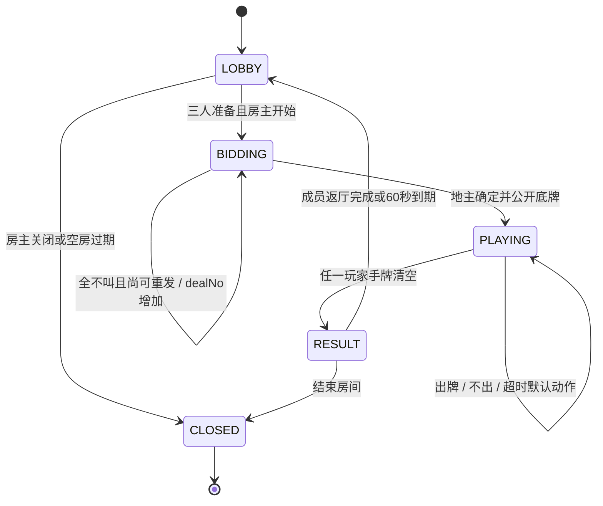
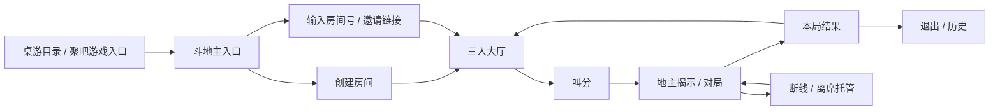

# Friemi 斗地主开发与设计方案

> 版本：v0.4 · 2026-10-16 · 状态：已在「二游」分支开始实施；按用户对欢乐斗地主/JJ斗地主牌桌的反馈重做手牌与动效，当前完成情况见[实施与验收记录](doudizhu-implementation.md)。
>
> 开发顺序已确定为「斗地主 → 四川麻将」。本文同时保存三个既有游戏 Agent 的经验，作为后续两款游戏共同参考。
>
> 用户已授权创建分支并开始落实。首版采用本文默认房规，冻结为 `friemi-ddz-v1`；本文仍保存完整设计目标，具体已实现和待验收项目以实施记录为准，每局开始后规则保持不变。

**快速阅读：** 第 3 章是两款游戏共用经验；第 4–7 章是斗地主规则和逻辑；第 8–12 章是 UI、动效、猫和声音；第 14–15 章是实施与验收；第 16 章保留麻将后续方向（同样采用手机横屏牌桌）。具体房规和参数集中列在第 17 章，便于评审时修改。

## 目录

- [1. 产品目标与首版范围](#1-产品目标与首版范围)
- [2. 现有实现、来源与复用边界](#2-现有实现来源与复用边界)
- [3. 两款游戏共用的开发与设计原则](#3-两款游戏共用的开发与设计原则)
- [4. 斗地主首版规则](#4-斗地主首版规则)
- [5. 房间、掉线、托管与再来一局](#5-房间掉线托管与再来一局)
- [6. 规则引擎与状态机](#6-规则引擎与状态机)
- [7. 服务端、持久化与同步](#7-服务端持久化与同步)
- [8. 页面流程与 UI 设计](#8-页面流程与-ui-设计)
- [9. 视觉规范与响应式](#9-视觉规范与响应式)
- [10. 动效方案](#10-动效方案)
- [11. 猫角色与表情](#11-猫角色与表情)
- [12. 音效、语音与背景音乐](#12-音效语音与背景音乐)
- [13. 工程拆分与资源清单](#13-工程拆分与资源清单)
- [14. 开发阶段、交付物与验收](#14-开发阶段交付物与验收)
- [15. 规则与恢复测试样例](#15-规则与恢复测试样例)
- [16. 四川麻将后续复用与独立工作](#16-四川麻将后续复用与独立工作)
- [17. 产品选择与风险记录](#17-产品选择与风险记录)
- [18. 开工顺序与完成定义](#18-开工顺序与完成定义)

## 1. 产品目标与首版范围

### 1.1 要交付的体验

朋友在 Friemi 打开斗地主，创建房间并邀请另外两人，选择自己的猫、准备、叫地主、出牌，得到清楚的结果，之后继续或离开。手机上能看清牌、选对牌、知道轮到谁；断线回来仍是原来的牌局。

**2026-10-16 用户明确调整：斗地主与后续四川麻将的手机牌桌强制横屏。** 入口和大厅可适配竖屏，叫分、正式对局和结果使用横屏牌桌；浏览器支持时在用户手势后请求全屏与横屏锁定，不支持时显示转屏引导。

视觉定位是「朋友围着一张轻盈、有触感的玩具牌桌」。保留现有雾蓝与奶白、猫角色和厚底按钮，加入纸牌的堆叠、轻微投影和桌面空间感。主要辨识点是**自己的猫与一手可直接操作的扑克牌**。

### 1.2 首版范围

| 项目 | 首版规划 |
| --- | --- |
| 人数与关系 | 固定三位登录用户，好友邀请房；一位地主对两位农民 |
| 玩法 | 54 张普通扑克牌，单一叫分制，完整合法牌型，单局计分 |
| 基础流程 | 建房、邀请、加入、选猫、准备、叫分、出牌、不出、结算、返厅 |
| 可用性 | 本人提示出牌、整理手牌、明确失败原因、基础托管、重连 |
| UI | 手机牌桌强制横屏，竖屏显示旋转引导；平板和桌面适配 |
| 内容 | 简体中文、英语、法语；规则、报错、读屏文案一起覆盖 |
| 角色 | 复用现有 15 只猫；公开身份徽章、轮次反馈、主动表情 |
| 声音 | 真实纸牌操作音、专属牌型音效、中英法合成播报、低音量循环音乐；音效/语音/音乐独立控制 |
| 计分 | 房间内娱乐积分与单局历史；不接入余额、商城或兑换资产 |

首版不包含匹配、段位、赛事、观战、实时语音聊天、策略机器人、癞子玩法、四人斗地主、多套可切换房规、完整牌局回放。测试夹具可驱动三个身份，不作为面向用户的「单人模式」。基础超时托管不等于有策略的电脑对手。

### 1.3 开发量口径

三个 Agent 的估算集中在：固定规则的斗地主真人可玩版约 12–20 人日，加入充分恢复与移动端打磨约 15–25 人日；同等范围的四川麻将约为 2–3 倍。这里只用于识别成本和安排顺序，没有实际工时记录支持，也不是交付日期承诺。

本文增加了完整声音控制、素材整理和较细的验收要求，正式排期应按第 14 章重新拆分。人日表示总投入，不能直接换算成 Agent 的连续运行时长。

## 2. 现有实现、来源与复用边界

### 2.1 本次调查的代码位置

| 来源 | 核对位置与状态 | 有价值的能力 | 不能直接推断的结论 |
| --- | --- | --- | --- |
| 双模式 / 你画我猜 | `/home/ubuntu23/Bureau/friemi`；含当前工作区修改 | 房间、身份、服务端裁决、私有视图、恢复、猫角色、音效和两首 BGM | 本地与历史验证不等于当前生产或真机验收 |
| UNO | `/home/ubuntu23/Bureau/friemi-worktrees/uno-logo-dev-20261011`；核对 HEAD `3195e71a` | 私有手牌、规则版本、命令回执、并发保护、手牌交互、局间恢复 | UNO 规则引擎不是通用扑克引擎；最新验证包含内存数据库替身 |
| 骰子 | `/home/ubuntu23/Bureau/friemi-worktrees/dice-entry-logo-20261011`；核对 HEAD `8ee69b68` | 2–6 人房间、私骰、结果驱动动画、实录音频、异步音频取消 | 骰子没有回合倒计时；离席重发骰不能移植到扑克；单人 runtime 与多人组件能力不同 |

当前聊天目录 `/home/ubuntu23/Documents/ChatGPT/friemi` 是较旧的架构资料目录。本文保存在完整仓库的 `docs/v2_8`。实施前应以实际集成分支为准，核对三个工作树的最新改动，按能力选取，不覆盖其他开发中的修改。

`friemi-table-games` 技能中「尚无 DICE」等描述来自 2026-10-11 快照；本次已被骰子最新代码更新。旧设计文档、旧截图和资源文件的存在，不构成功能已上线的证据。

### 2.2 最值得复用的文件

以下路径相对对应代码位置；实施时优先使用已合入目标分支的版本，不能仅凭主目录文件名相同就判断相同。

| 能力 | 来源与路径 |
| --- | --- |
| 共享房间、房间入口 | 主仓库 `apps/web/features/game-tools/gameToolRooms.ts`、`gameToolCatalog.ts`、`activeGameToolRoomStorage.ts` |
| 规则 / 服务分离与命令回执 | UNO 工作树 `apps/web/features/game-tools/unoEngine.ts`、`unoRoomServer.ts`、`unoRoomRequest.ts` |
| 手牌、选择、菜单及短屏适配 | UNO 工作树 `apps/web/features/game-tools/components/UnoTable.tsx`、`UnoGame.module.css`、`UnoChrome.tsx` |
| 猫角色目录与动作 | 主仓库 `apps/web/features/game-tools/drawGuessCats.ts`、`components/DrawGuessCatSprite.tsx` |
| 大厅、游戏导航与安全区 | 主仓库 `apps/web/features/game-tools/components/DrawGuessLobby.tsx`、`GameToolBrand.tsx`、`GameToolsMobileChrome.tsx` |
| 音效 / 音乐控制 | 主仓库 `apps/web/features/game-tools/drawGuessSound.ts`、`components/DrawGuessInteractionSounds.tsx`、`DrawGuessVolumeControls.tsx` |
| 音源出处 | 主仓库 `apps/web/public/sounds/draw-guess/AUDIO_SOURCES.md` |
| 实录处理与取消机制 | 骰子工作树 `apps/web/features/game-tools/dice-preview/runtime/dice-device.js`、`tools/prepare_audio.py`、`apps/web/public/sounds/dice/LICENSE.md` |
| 设计基线 | [Friemi UI 开发准则](../ui-design-system.md)、主仓库 `apps/web/app/globals.css`、`apps/web/lib/brandPalette.ts` |

### 2.3 三个 Agent 的经验归纳

| Agent | 已发生的经验 | 本项目的落实方式 |
| --- | --- | --- |
| UNO | 房规变化会连带修改引擎、UI、说明、历史兼容和测试 | 先固定完整规则表、牌型边界和结算样例，存 `rulesetVersion` |
| UNO | 请求失败可能只是响应丢失；重试容易重复出牌或结算 | 命令绑定操作者、牌局、回合与原始 ID；回执持久保存 |
| UNO | 心跳不一定增加房间版本；清席位会误伤刚重连的人 | 房主接任、清理席位在事务内重新检查成员活动 |
| UNO | 透明导航挡按钮、菜单越界、弹窗遮重试入口 | 除截图外检查真实点击命中、焦点、旋转与恢复流程 |
| 骰子 | 本机样机到真人房间是一整段后端开发 | UI 预览与真人多人分别验收；原型与正式界面共用规则与组件 |
| 骰子 | 用户否定机械、奇怪的合成摇骰声；混合音源音色不一致 | 新纸牌音效优先同一套真实录音，统一加工与试听 |
| 骰子 | 音频晚解码、旧动画晚完成会污染下一次动作 | 事件 ID、播放代次、有效期、取消信号贯穿表现层 |
| 双模式 | 用户否定杂色、过粉、重纹理、冗长解释、工具页感 | 紧凑配色、清楚牌桌、渐进规则、短反馈 |
| 双模式 | 猫侧面、配饰、眼睛和小尺寸表现需要逐项检查 | 角色 × 视角 × 表情 × 尺寸接触表，不以增加帧数代替修形 |
| 双模式 | 正常阶段结束曾显示成红色错误 | 游戏输赢、正常等待与系统错误使用不同语义 |
| 三者 | 同步、重连、退出、等待、结果比正常演示更容易遗漏 | 从首版纳入完整状态表和异常路径验收 |

## 3. 两款游戏共用的开发与设计原则

### 3.1 产品与信息

1. 入口突出创建、加入；房规与声音设置渐进展开。桌游目录沿用现有两列竖卡、图上字下，内部链接使用右箭头。
2. 当前行动者、自己的牌、公开动作、剩余时间、可用操作和连接状态持续可辨认。
3. 页面只说一次同一件事；保留真实失败原因和下一步，删除口号及重复教学。
4. 牌桌布局由玩法决定。共同的是身份、按钮、角色、反馈和声音约定，不统一成同一张万能桌面。
5. 规则变更撤销准备；纯外观变化不撤销准备。正式开始后冻结房规、座位和角色。

### 3.2 服务与数据

1. 纯规则引擎负责判断；服务端决定身份、随机结果、时间和结算；客户端只提交意图。
2. 先生成每位玩家的授权视图，再返回 API。房主没有额外看牌权限，队友也不能看彼此手牌。
3. Broadcast 只通知状态版本变化；授权快照是恢复依据；轮询、回前台和网络恢复作为兜底。
4. 命令重试与回执、事务并发保护、独立超时推进从第一版建设。
5. 观战、主动离席、断线、失去登录状态分别处理；不能简单以浏览器断开事件删除席位。
6. 每种游戏保留独立的规则状态、动作与结算。四川麻将后续采用响应窗口，不强塞进斗地主的单人回合。

### 3.3 动效、角色与声音

1. 按压和选牌立即反馈；成功动作与胜负演出只消费服务端已接受、当前用户可见的事件。
2. 动画完成回调不能推进牌局。跳过动画、无声、减少动态都能完成游戏。
3. 快照恢复直接落到当前画面，不补播历史发牌、欢呼或报牌。
4. 宠物公开反应只受公开事件驱动；不能通过表情、气泡、动作或音效泄露牌力、听牌、可胡或策略判断。
5. 角色身份与游戏身份分开：`appearance.catId` 与 `gameRole` 独立；不让地主标记覆盖猫角色。
6. 音效、语音、背景音乐分通道；偏好跨页面保存，后台暂停，异步恢复时丢弃过期声音。
7. 小尺寸降低细节，角色列表静态展示，离屏暂停，默认不让全桌角色持续大幅活动。

## 4. 斗地主首版规则

### 4.1 规则口径

本章为拟定的 `friemi-ddz-v1` 房规。基础玩法参考 [JJ 斗地主规则](https://www.jj.cn/news/320/20110920103700018196.shtml)中的三人、底牌、叫分与出牌结构；下列带牌限制、全员不叫处理、计时、倍数与托管均以本方案的明确选择为准，不宣称是唯一官方规则。

### 4.2 用牌、座位与发牌

| 项目 | 建议规则 |
| --- | --- |
| 牌库 | 52 张四花色牌 + 小王 + 大王，共 54 张；每张有唯一 `cardId` |
| 大小 | `3 < 4 < 5 < 6 < 7 < 8 < 9 < 10 < J < Q < K < A < 2 < 小王 < 大王`；花色不参与比大小 |
| 发牌 | 服务端使用密码学随机源洗牌，三人各 17 张，留 3 张底牌 |
| 初始信息 | 叫分前仅本人可见自己的 17 张；其他人只见张数，底牌为牌背 |
| 座位 | 开局锁定三个座位；`nextSeat = (seat + 1) % 3`，自己看见的下家在右上、上家在左上；各终端相对旋转而不改变座位顺序 |
| 叫分起点 | 每局首次发牌随机选择首叫者；同局重新发牌时首叫者向下一位轮换 |
| 地主确定 | 将 3 张底牌加入地主手牌，地主 20 张、农民各 17 张；底牌此后对三人公开 |
| 首出 | 地主先出；无换牌、无明牌、无癞子、无底牌额外倍数 |

随机结果在服务端接受开局或重发时保存。重试、刷新、重连不得重新洗牌；不向客户端发送随机种子或未公开牌序。密码学随机源不等同于可由玩家验证的洗牌协议，首版不作此承诺。

### 4.3 叫分

1. 每人依次获得一次叫分机会：可「不叫」，或叫高于当前最高值的 `1 / 2 / 3` 分。低于或等于最高值的选项不可提交。
2. 有人叫 3 分立即结束叫分；否则三人完成后最高叫分者成为地主。
3. 三人都不叫：前两次整副重发，不计分，`dealNo` 增加、首叫者轮换。
4. 第三次发牌仍全员不叫：第三次的首叫者按 1 分成为地主，底牌公开；房间规则须说明这一保底方式，避免无限重发。
5. 默认每次叫分 20 秒，超时视为不叫并进入托管。叫分动画不增加或暂停计时。

这是一套建议默认值。若产品更偏好抢地主或立即指定地主，应在开发引擎前替换整套规则及样例，首版不同时实现多个分支。

### 4.4 牌型与比较

下表中「主体」指用于比较大小的单牌、对子、三张、连续三张或四张；附带牌不决定大小。所有连续主体最高到 A，不能包含 2 或王。

| 牌型 | 合法组成 | 比较依据 |
| --- | --- | --- |
| 单张 | 任意 1 张 | 点数 |
| 对子 | 同点数 2 张；大小王不是对子 | 点数 |
| 三张 | 同点数 3 张 | 点数 |
| 三带一 | 三张 + 不同主体点数的单张 | 三张点数 |
| 三带二 | 三张 + 不同主体点数的一对 | 三张点数 |
| 顺子 | 至少 5 个连续点数，每点 1 张 | 同长度，比较最大点数 |
| 连对 | 至少 3 个连续点数，每点 2 张 | 同对数，比较最大点数 |
| 飞机不带牌 | 至少 2 个连续点数，每点 3 张 | 同段数，比较主体最大点数 |
| 飞机带单翅 | `m ≥ 2` 个连续三张 + `m` 张单翅，共 `4m` 张 | 同段数、同带牌类型，比较主体最大点数 |
| 飞机带双翅 | `m ≥ 2` 个连续三张 + `m` 个对子，共 `5m` 张 | 同段数、同带牌类型，比较主体最大点数 |
| 四带二单 | 四张 + 2 张附带牌，共 6 张 | 四张点数 |
| 四带两对 | 四张 + 2 对附带牌，共 8 张 | 四张点数 |
| 炸弹 | 仅同点数 4 张 | 大于所有普通牌型；炸弹之间比较点数 |
| 火箭 | 小王 + 大王，恰好 2 张 | 最大；不能被压过 |

**必须实现的带牌边界：**

- 飞机单翅的各单翅点数互不相同，不能与主体点数重复；允许带一张王或 2，不允许同时带大小王。此为首版明确选定的房规。
- 飞机双翅必须是不同点数的完整对子，不能与主体点数重复；不能将四张同点数当成两对翅膀。
- 四带二单允许附带一对，例如 `4444 + 55`；不允许附带大小王组合。
- 四带两对要求两个对子点数不同，且都不同于主体；`4444 + 5555` 不成立。
- 三带一允许单王；不能拿主体第四张作为其附带牌，`4444` 识别为炸弹。
- 主体从手牌中选出三张时可以暂留第四张在手里；限制针对本次提交的牌组，不禁止拆牌。
- 普通牌型只能与**相同牌型、相同总张数、相同连续段数**比较；四带二不是炸弹。
- 识别结果只由提交的唯一牌 ID 集合决定。服务端枚举合法主体并规范化；若仍存在多种合法解释，固定取主体最大点数最高的解释，显示同一结果，不能依赖客户端提交的牌型名称。

### 4.5 出牌、不出与牌权

1. 新一墩的首出者可出任意合法牌型，不能「不出」。
2. 跟牌者可出比当前有效牌组大的牌，或选择不出；即使有牌能压过，也允许不出。
3. 有人成功压过，当前有效牌组和拥有者更新，连续不出计数归零。
4. 另外两人连续不出，旧牌组结束，牌权回到最后成功出牌者；建立新 `trickId`，该玩家自由首出。
5. 手牌一旦清空立即判定所属阵营获胜，不再等待另外两人不出。
6. 农民共享胜负，但不能查看队友手牌。结算时公开三人的剩余手牌，局内仍严格保密。
7. 余牌数对所有人公开；剩 2 张或 1 张时可有简短公开提示，不泄露牌面。

### 4.6 计分、炸弹与春天

设 `B = 地主叫分（1 / 2 / 3）`，`N = 本局实际打出的炸弹数 + 火箭数`。

- 每个炸弹或火箭使倍数 ×2；打出四带二不翻倍。
- 地主获胜，且两位农民都未成功出过牌：春天，额外 ×2。
- 农民获胜，且地主仅成功出过一次牌：反春天，额外 ×2。
- 不出、非法提交、重复请求不计入成功出牌次数。
- 推荐总倍数 `M = min(2^(N + 春天标记), 64)`；`春天标记` 为 0 或 1。叫分不占用 64 倍上限。
- 地主胜：地主 `+2BM`，每位农民 `−BM`；农民胜则完全相反。
- 末张炸弹 / 火箭先计入倍数，再判定春天和结算。得分始终为整数，三人之和必须为 0。
- 托管和主动离席不改变胜负及分数，也不能通过退出逃避本局结算。

| 样例 | 计算 | 地主 / 农民甲 / 农民乙 |
| --- | --- | --- |
| 叫 2 分，1 个炸弹，地主胜，无春天 | `B=2, M=2` | `+8 / −4 / −4` |
| 叫 3 分，1 个炸弹，农民胜且反春天 | `B=3, M=4` | `−24 / +12 / +12` |
| 叫 1 分，无炸弹，地主春天 | `B=1, M=2` | `+4 / −2 / −2` |
| 叫 3 分，翻倍因素达到 7 次 | `B=3, M=64`，展示已封顶 | 地主胜时 `+384 / −192 / −192` |

结果同时展示胜方、每人本局变化、叫分、炸弹 / 火箭次数、春天与实际倍数。默认6局一场，房主可选1、3、6、12局，整场按累计分排名，积分相同并列。累计分绑定同一场的三人阵容；重连保留，参与账号或座位阵容变化后为新阵容重新计分，原参与者仍可查看自己的历史。完整规则见[房间与多局方案](doudizhu-room-match-plan.md)。

### 4.7 提示出牌

首版提供本人可见的合法出牌提示，不承诺最优策略。输入仅为自己的手牌、公开有效牌组和规则，不能使用对手手牌。

跟牌时先列同牌型可压过的组合，再列炸弹和火箭；按主体从小到大、尽量少拆完整组的固定顺序循环。首出时给出若干完整牌组与单张。提示只改变本地选中态，必须再点「出牌」。无解时显示「没有能压过的牌」，不自动替用户不出。规则验证和提示生成使用同一组判定函数。

## 5. 房间、掉线、托管与再来一局

### 5.1 大厅

- 三个固定位置；房主也需明确准备。房主在三人在线且全员准备时开始；开始与准备、退出、设置修改并发时，以事务内最新状态裁决。
- 大厅提供局数1/3/6/12和出牌时限30/60/90秒，默认6局、60秒。仅房主可在开场前或整场完成后的大厅修改；一场开始后连同局间锁定。实际修改清空所有准备，重复/同值保存不清空。猫角色可在大厅更换，保留准备与累计积分。
- 房主只可在大厅移除成员；不得在叫分或出牌阶段踢人、重置牌局或改规则。
- 正式开始后拒绝新人入座和观战；原参与者可恢复自己的席位。
- 账户没有可用登录时，完成登录后返回原邀请；房间不存在、已满、正在游戏分别给出恢复入口。

### 5.2 断线与托管

| 场景 | 建议处理 |
| --- | --- |
| 切后台 / 短时断线 | 保留手牌、座位、角色和原截止时间；不重新发牌，不立即替用户操作 |
| 首次行动超时 | 服务器执行默认动作，并开启该座位托管；公开显示「托管中」 |
| 已托管的后续回合 | 4 秒后执行默认动作，给回来的人解除托管的机会；不按帧连续自动出牌 |
| 默认叫分 | 不叫 |
| 默认首出 | 出当前最小单张；这是确定性基础托管，可能拆牌，不保证策略合理 |
| 默认跟牌 | 超时一律不出；即使整手牌可压过并一次出完，也不替玩家决定出牌 |
| 重新在线 | 恢复快照；托管仍明确显示，用户点击「接管」后恢复人工操作 |
| 接管 | 不重置当前截止时间；若服务器已执行则以新回合为准；点接管不能无限延长回合 |
| 主动离席 | 确认「离开后本局由系统代打，积分照常结算」；锁定席位仍属于本人，允许恢复 |
| 登录失效 / 用户不可用 | 不泄露快照；原席位仍按超时托管完成本局 |
| 全员离线 | 独立调度继续推进到结果，不依赖任何客户端在线 |

默认人工出牌时间 60 秒，与现有 UNO 默认值一致，可在房间设置中选择30或90秒；叫分20秒，后续托管回合4秒。旧存档保持进行中牌局的原时限，下一场采用新设置。客户端倒计时校准到服务端时间；以服务器锁定当前状态后取得的判定时间裁决，`now >= deadlineAt` 时先处理到期，旧回合动作不再接受。客户端显示0不代表有权自行推进。

### 5.3 房主与共享活动房间

房主主动离席时向在线成员移交；超过 60 秒无活动时允许在线成员接任。房主用于大厅管理，不参与改变牌局结果。接任事务重查心跳，避免把刚恢复的房主误判为离线。

主动离席后可以释放共享「正在游戏」入口占用，但本局参与和计分记录保留；恢复必须绑定原 `roomId`，不能只按可能被复用的房间号加入。不同账号切换时清除旧手牌和活动房间缓存；新开局时检查共享占用，防止无意同时占两个活跃席位。

### 5.4 结果与再玩

每位玩家都能独立查看本局结果、展开计分、返回大厅或离开。正在浏览结果的人不被某位房主直接拉进下一局。

- 全部仍在线且未主动离席的成员选择返厅后，房间转换为大厅；最长结果阶段建议 60 秒，之后进入大厅但保留可再次打开的上局结果。
- 转换大厅时再次校验成员心跳；清理已主动离席及持续离线的占位，保留刚重连的人。
- 所有准备清零，房规及保留成员的猫不变；新一局仍要求三人重新准备和房主开始。
- 牌桌显示第N/M局，局间保留累计分；全不叫重发不增加局数。打满后显示整场排名，返回大厅再开一场时清零累计分，房间历史局号继续递增。大厅、牌桌和结果页均可打开累计与逐局记分板。
- 房间关闭只能发生在大厅 / 结果阶段；进行中离开不能强制取消别人牌局。
- 大厅全员离开后进入可清理状态；建议空房 30 分钟关闭。已结算记录独立保留。

## 6. 规则引擎与状态机

### 6.1 状态流



`DEALING`、地主揭示、炸弹演出都是客户端表现，不是阻塞规则推进的阶段。发牌和地主揭示应足够短，使玩家在既定计时中正常操作。

### 6.2 状态模型草案

```ts
type DdzPhase = 'LOBBY' | 'BIDDING' | 'PLAYING' | 'RESULT' | 'CLOSED';

type DdzState = {
  schemaVersion: number;
  rulesetVersion: 'friemi-ddz-v1';
  rules: DdzFrozenRules;
  gameNo: number;       // 房间内单调递增；每次正式开始增加
  dealNo: number;       // 本局内因全员不叫重发而增加，初始1
  turnId: number;       // 房间内单调递增，不随新局清零
  trickId: number;      // 本局牌权轮次
  eventSeq: number;     // 房间内事件游标
  phase: DdzPhase;
  players: DdzPlayer[]; // profileId只供服务端；appearance与gameRole独立
  hands: Record<Seat, CardId[]>;  // 仅服务端
  handVersions: Record<Seat, number>;
  bottomCards: CardId[];         // 叫分结束前仅服务端
  landlordSeat: Seat | null;
  bid: DdzBidState;
  currentSeat: Seat | null;
  targetPlay: CanonicalPlay | null;
  consecutivePasses: number;
  playedCards: CardId[];         // 已消费的牌，守恒校验
  playCounts: Record<Seat, number>;
  multiplier: number;
  bombCount: number;
  managedSeats: Seat[];
  deadlineAt: number | null;
  result: DdzResult | null;
};
```

`bottomCards` 在地主确定后只是三张公开牌的引用，不再是一个独立持牌区。守恒断言：叫分时「三人手牌 + 未分配底牌 = 54」；出牌时「三人手牌 + 已出牌 = 54」，不能把公开底牌重复计入。

### 6.3 纯引擎职责

| 函数草案 | 输入 / 输出与职责 |
| --- | --- |
| `createDdzDeck` | 创建 54 个不同 ID，定义 rank / suit / joker |
| `startDdzGame` | 接收已生成的牌序、规则和服务端时间；建立叫分状态 |
| `classifyDdzPlay` | 验证牌 ID 唯一、牌型合法；输出规范牌型及主体 |
| `beatsDdzPlay` | 比较规范牌型；不依赖 UI 或文本名称 |
| `listDdzHints` | 本人手牌 + 公开牌组生成合法候选 |
| `applyDdzAction` | 应用 BID / PLAY / PASS / SET_MANAGED；返回新状态和领域事件 |
| `advanceDdzDeadline` | 与动作入口共用超时规则，一次推进当前到期阶段 |
| `settleDdzGame` | 计算胜方、倍数、春天和零和积分，保持结果不可改写 |
| `getDdzViewerState` | 输出当前成员的公开视图和自己的私有手牌 |

随机源、时间与身份由服务端注入；引擎不调用数据库、不读取浏览器存储、不播放音效。测试可注入固定牌序和时钟。提示与最终验证共用牌型规则，避免按钮认为可出而服务端拒绝。

牌型识别先按点数计数，再依据提交张数枚举可能主体，扣除主体后检查附带牌。提示按牌型生成候选，不暴力枚举全部54张牌的子集；相同点数的等价花色组合按稳定顺序规范化，避免提示反复给出实际上相同的一手牌。

### 6.4 关键不变量

同一张牌不能出现在两个持牌区；一局最多结算一次；同一回合最多一个行动成功；三人积分和为零；结果阶段无出牌；当前有效牌组一定来自已接受出牌；两次连续不出后只能由最后出牌者首出；房规冻结；任何公开视图不能带出未公开手牌或牌序。

## 7. 服务端、持久化与同步

### 7.1 命令协议

```ts
type DdzCommand = {
  commandId: string;        // UUID；同一意图重试保留，不同意图重新生成
  gameNo: number;
  dealNo: number;
  expectedPhase: DdzPhase;
  turnId: number;
  handVersion?: number;    // PLAY必填
  expectedRevision?: number; // 大厅管理写入必填
  action:
    | { type: 'START' }
    | { type: 'BID'; score: 0 | 1 | 2 | 3 }
    | { type: 'PLAY'; cardIds: string[] }
    | { type: 'PASS' }
    | { type: 'SET_MANAGED'; managed: boolean };
};
```

操作者由 Clerk 与活跃 `UserProfile` 推导，接口不接受可冒充他人的 `profileId` / `seat`。服务端忽略客户端声明的牌型、胜方、得分、时间和洗牌结果。

处理顺序：认证身份 → 原操作者绑定的命令回执检查 → 当前成员与座位权限检查 → 当前阶段和轮次检查 → 事务内锁定 / 重读房间及判定时间 → 处理已到期阶段 → 验证合法动作 → 写入状态、回执、事件和必要结算 → 提交后广播版本通知。

已完成离开的重试可以向原操作者确认最小回执，但没有当前成员权限时不能附带房间快照。不能因为检查了旧回执，就恢复旧席位或绕过现在的访问权限。

- 同一个 ID 绑定账号和规范化完整请求哈希；换内容复用 ID 或由其他账号复用必须拒绝。
- 已接受的重复 ID 只确认原结果，返回当前授权视图，不再次执行动作；即使已进入下一局也不能改写新局。
- 正常出牌用语义轮次、手牌版本校验，避免仅因其他人发了表情导致不必要的拒绝；事务冲突时重新读取并重新判定，最多重试 6 次。
- 大厅准备、设置、选角、返厅、离开同样携带稳定命令 ID 与原始版本，统一持久回执；不同意图不得盲目重试。
- 失败分为明确拒绝、结果未知和登录失效。网络超时不等于操作失败；结果未知时保留原请求并刷新快照，必要时以同一 ID 重试。
- 表情命令另行携带 `gameNo`、阶段和 `reactionId`，不改变行动时钟；旧局未接受的表情不能进入新局。

### 7.2 持久化草案

沿用共享 `GameToolRoom / GameToolSeat / GameToolRoomMember`；新增 `DOUDIZHU` 类型以及独立领域表，名称以实际迁移审查为准。

共享房间状态映射：领域 `LOBBY` → 共享 `LOBBY`；`BIDDING / PLAYING` → `IN_PROGRESS`；`RESULT` → `FINISHED`；`CLOSED` → `CANCELLED`。截止扫描应覆盖叫分、出牌、结果返厅等有截止时间的阶段，不能只扫描 `IN_PROGRESS` 而遗漏结果返厅。

| 数据 | 计划内容 |
| --- | --- |
| Room | state、revision、`ddzDeadlineAt`、房主、关闭状态；索引 `(kind, status, ddzDeadlineAt)` |
| 外观 | 建议共享 Seat 增加独立 `appearance` JSON `{catId}`；斗地主 `gameRole` 存本局状态。现有游戏的 `roleKey` 不改语义、不强制迁移 |
| `DdzCommand` | `(roomId, commandId)` 唯一；actorProfileId、请求哈希、局号、最小回执、时间；回执不存完整手牌快照 |
| `DdzRound` | `(roomId, gameNo)` 唯一；规则快照、参与者账号与昵称 / 猫快照、叫分 / 倍数 / 结果、结束时间 |
| `DdzEvent` | `(roomId, eventSeq)` 唯一；公开动作和结果事件；与状态同事务写入；不存未公开发牌内容 |

历史授权绑定当局参与账号，不能按可复用的座位号授权。历史展示最近 20 局的结果摘要，首版不提供完整回放。建议完整房间状态和回执保留到房间关闭后 7 天，结果摘要保留 90 天；清理期间不得留下仍可访问、却失去去重约束的房间。

当前结果页可读取该局按规则公开的剩余手牌；长期历史摘要只保存计分、房规与参与者外观，不保留完整手牌。清理共享 Room 时不得级联删除尚在90天保留期的 `DdzRound`：可保留去除敏感state的房间壳，或将摘要关系设计成可独立保留。

迁移需包含数据库读取权限检查：浏览器角色不能绕过 API 直接读取完整 state、私有回执和参与者账号列表。新类型不能因共享表既有策略而意外暴露；RLS 与服务端鉴权分别验证。

### 7.3 API 草案

统一前缀 `/api/game-tools/doudizhu`。所有写入校验同源、成员、阶段和频率；响应私有且禁止公共缓存。

| 路径 | 用途 |
| --- | --- |
| `POST /rooms` | 创建固定三人房，返回 roomId / code；带创建请求 ID 防重复房间 |
| `POST /join` | 房间号加入；恢复时附 expectedRoomId，避免旧号重用 |
| `GET /rooms/:id` | 授权快照，含 serverNow、revision、本人视图和近期公开事件 |
| `POST /rooms/:id/ready` | 准备 / 取消准备；版本与命令 ID |
| `PATCH /rooms/:id/character` | 本人大厅选猫；版本与命令 ID |
| `PATCH /rooms/:id/settings` | 房主修改局数与出牌时限；整场开始后锁定，版本与命令ID |
| `POST /rooms/:id/actions` | 开始、叫分、出牌、不出、托管切换 |
| `POST /rooms/:id/reactions` | 主动表情；局号绑定、冷却与去重 |
| `POST /rooms/:id/leave` | 大厅离开 / 对局离席托管 |
| `POST /rooms/:id/return` | 结果返厅 |
| `POST /rooms/:id/remove` | 房主移除大厅成员；禁止局内踢人 |
| `POST /rooms/:id/close` | 关闭大厅 / 结果房间；进行中拒绝 |
| `GET /rooms/:id/history` | 仅本人参与过的计分摘要 |
| `/api/cron/doudizhu-deadlines` | 服务端密钥授权的独立截止扫描 |

API 错误建议包括 `SIGN_IN_REQUIRED`、`ROOM_FULL`、`GAME_STARTED`、`NOT_A_MEMBER`、`STALE_TURN`、`STALE_HAND`、`INVALID_COMBINATION`、`CANNOT_BEAT`、`MUST_LEAD`、`RESULT_UNCERTAIN`；客户端将其映射为自然语言，不把内部代码直接放到牌桌上。

### 7.4 快照、广播与时间

- Broadcast 载荷只含 roomId / revision。房间频道仍须授权，不使用公共频道携带私有状态。
- 客户端只接受更高 revision；相同版本可更新经校验的时钟样本，不重播表现事件；切账号先清空旧视图。
- 正常连接建议 12 秒一次兜底刷新，频道断开 3 秒一次；后台降低刷新，前台 / online 立即恢复。后续按真实延迟与负载调整。
- 请求合并，旧 GET 可取消，过时响应不能覆盖新账号或新房间。轮询停止不影响服务器计时。
- 快照使用 `serverNow` 配合本地单调时钟计算倒计时，不直接相信手机系统时间。
- 调度目标每 2 秒扫描到期房间；一次房间事务只推进一个已到期行动，新托管截止从本次推进的服务器时间计算，避免恢复时瞬间连走整局。
- GET / 动作入口与扫描共用到期函数；调度重复执行只推进一次。生产验收必须检查实际任务运行，而不只是存在 cron 路由。

### 7.5 对外视图清单

| 信息 | 叫分中 | 出牌中 | 结果 |
| --- | --- | --- | --- |
| 本人手牌 | 本人 | 本人 | 当局三人可见剩余牌 |
| 对手手牌 | 隐藏，仅张数 | 隐藏，仅张数 | 当局三人可见剩余牌 |
| 底牌 | 隐藏 | 三人公开 | 公开 |
| 玩家角色、准备、托管 | 公开 | 公开 | 公开 |
| 叫分、已出牌、当前倍数 | 已发生部分公开 | 公开 | 公开 |
| 提示候选、本地选牌 | 仅本人 | 仅本人 | 不保存进历史 |
| 原始牌序、私有令牌、内部账号列表 | 不返回 | 不返回 | 不返回 |

## 8. 页面流程与 UI 设计

### 8.1 路由与完整路径

计划新增 `/[locale]/game-tools/doudizhu`、`/join/[code]`、`/rooms/[roomId]`、`/rooms/[roomId]/history`。登录后的返回地址只能来自允许的站内路径。



### 8.2 每屏内容与操作

| 页面 / 状态 | 第一眼看见 | 主要操作 | 次要操作与异常 |
| --- | --- | --- | --- |
| 入口 | 扑克牌与猫组成的小场景、斗地主、三人好友局 | 创建房间 | 输入房间号、返回桌游；存在未结束牌局时优先「回到牌局」 |
| 输入房间号 | 单个可见标签输入框 | 加入 | 支持粘贴、大小写标准化；逐项解释房间满 / 不存在 / 已开局 |
| 大厅 | 三个猫座位、昵称、准备状态、房主标记、房间号 | 准备；房主条件满足后开始 | 邀请、选猫、规则、声音；仅房主可移除未开局成员 |
| 叫分 | 自己 17 张牌、三张底牌背面、当前叫分者、已叫最高分 | 不叫 / 可用分数 | 对手叫分气泡；低分选项禁用且解释；重发短提示 |
| 地主确定 | 地主徽章、公开底牌、自己的身份 | 自然进入出牌 | 公开奖励感短演出，不挡手牌，不弹确认框 |
| 自己回合 | 有效牌组、倒计时、抬起的已选手牌 | 出牌 | 提示、不出、整理、清空选择；无牌权目标时不出禁用 |
| 对手回合 | 对手轮次标记、最后公开出牌、自己的手牌 | 可预选牌 | 不能提前提交；进入自己回合后重新检查选择与有效牌组 |
| 托管 | 自己头像附近的托管标记和固定接管按钮 | 接管 | 说明剩余时间不重置；操作结果以服务器为准 |
| 网络结果未知 | 原选牌保留、局部「正在确认出牌」 | 重新确认原请求 | 声音与规则仍可打开；不要用全屏遮罩封死退出和恢复 |
| 本局结果 | 胜方、自己的分数变化、三人结果、猫庆祝 | 返回大厅 | 计分详情、剩余手牌、历史、离开 |
| 历史 | 最近参与局的时间、阵营、输赢与计分 | 展开某局 | 不提供未实现的完整回放按钮 |

创建按钮不要求用户先填写房名和大量设置。共享入口卡片使用扑克牌、桌面和猫表达玩法，不写长口号。首版没有单人模式，不能提供一个实际只进入三人假房间的「单人」按钮。

### 8.3 横屏牌桌信息线框

2026-10-16 用户明确原左右分栏UI不过关，要求参考欢乐斗地主与JJ斗地主的牌桌、牌距、叠放与发/出牌动效。以下替代早期竖屏及右侧手牌框方案。

```text
┌──────────────────────────────────────────────────────────┐
│ ‹ 斗地主  房间A7K2       底牌♠A ♥7 ♣3 / ×2      声音  ⋯ │
│ 上家猫 · 农民                                  下家猫 · 地主│
│ 余牌12           [中央当前有效牌组]                 余牌9 │
│ 上家动作            轮到你 · 24秒                 下家动作│
│              [ 不出 ] [ 提示 ] [ 出牌 ]                  │
│ 我的身份     [A[K[Q[J[10[9[8[7[6[5[4[3… 整手叠牌]       │
│               选中抬起；所有点数花色可见       展开 / 表情 │
└──────────────────────────────────────────────────────────┘
```

牌桌中央的「当前有效牌组」与各人的上一手不能混淆。上一墩结束后旧牌淡出或进入近期记录，当前目标区显示「你先出」，不让用户拿失效牌组比较。每个对手的最后动作靠近本人座位，清楚对应是谁出的。

### 8.4 桌面与横屏

- 桌面最大舞台宽度建议约 1100px；三角座位展开，下方手牌可铺得更宽；规则和声音仍作为轻量浮层。
- 矮横屏将紧凑信息与对手放在上半区，手牌铺满底部、主要操作在手牌上方中央；不再把整手牌装入右侧半屏面板。猫的尺寸让位于牌面与牌桌空间。
- 手机叫分/对局/结果强制横屏。竖屏用可访问转屏引导挡住牌桌操作；支持浏览器在显式手势后请求 `requestFullscreen()` 与 `screen.orientation.lock("landscape")`，不支持时要求用户横放设备。禁止把整个竖屏页面做 CSS 旋转冒充横屏。
- 转屏期间保持房间订阅和服务端计时，显示计时继续提示；手牌预选、当前回合与音频偏好保留。退出桌游解除本游戏取得的方向锁与全屏，不影响其他页面。
- 全屏是支持设备的横屏辅助入口。无需全屏也能在真实横屏浏览器中完整操作；iOS/WebView 的能力差异必须实测。

### 8.5 手牌多选与提示

1. 点一张牌选中，再点取消。选中用抬高、清楚描边和勾选共同表示；不只靠颜色。
2. 横屏整手牌一次可见，横向拖动专用于连续选牌。按起始牌当前状态决定本次选中或取消区间，返回拖动缩短区间；松手不提交。需要精确点选时使用网格展开。
3. 手牌默认按点数降序排列，同点数使用稳定花色顺序；「整理」恢复此顺序，不改变手牌内容。
4. 预选可以发生在对手回合，但每次轮次、手牌或目标牌组变化都重新验证；失效时保留尚持有的选择并显示简短原因，不自动出牌。
5. 按用户最新反馈，选牌只用手牌抬起与勾选表示，不显示选中张数、牌型或主体点数；公开牌下不重复显示姓名/牌型说明。非法组合、压不过及无可用提示时保留必要反馈。特殊牌型名称仅在短暂特效中出现。
6. 「出牌」只有在轮到自己、已选合法、可以压过目标、网络可用且没有未决命令时可用。按下后标为提交中，收到确认才从手牌移除。
7. 成功出牌清空选择；明确拒绝保留选择并刷新状态；结果未知保持原卡 ID 集合和命令 ID，不能生成新的出牌意图。
8. 「提示」循环候选，第一下选中建议组合；不直接出牌。「清空」只影响本地选择。新局 / 账号 / 房间切换全部清除。
9. 对手余牌 1 / 2 张使用公开的短提示；不显示概率、牌力评分或系统对手策略。

### 8.6 长手牌与触控精度

首版最多20张手牌。按用户要求采用斗地主惯用的整手叠牌：常规牌宽参考64–76px、高90–108px，根据实际容器计算步距，667px宽横屏下20张牌约27px步距，844px下约35px，少牌居中；最终值以安全区、浏览器栏及昵称等实际布局为准。每张完整点数与花色角标必须露出，10和大小王需要专门检查。卡片稳定按ID定位，选中抬起12–18px，出牌后其余牌平滑合拢。

提供「展开手牌」：打开可滚动的网格选牌面板，每张牌具有完整触控面积，底部仍可确认选择并返回桌面。面板仅改变本地选牌，不在里面自动出牌。焦点关闭后回到原触发按钮；当前轮次变化会同步显示，不停止计时。

叠牌暴露区约24–35px，不能声称每张独立暴露区都达到44px；这是用户要求的紧密叠牌交互，普通操作按钮及展开网格仍保持44px以上。读屏与键盘模式逐牌完整命名；方向键移动、Space切换，出牌仍经显式按钮。

### 8.7 等待、错误与弹窗

| 情况 | 文案方向 | 视觉 / 行为 |
| --- | --- | --- |
| 等朋友 | 「等待另外 1 位玩家」 | 空座与邀请按钮，不用永久骨架 |
| 对手行动 | 「桃桃正在出牌」 | 该座位轮廓 + 倒计时，猫轻微思考 |
| 两家不出 | 对应座位显示「不出」；当前行动为「你先出」 | 清除有效目标；两个「不出」保留约1.4秒便于读取，新有效出牌立即清除 |
| 网络中断 | 「连接中，牌局仍在继续」 | 局部状态条，禁用会改变牌局的动作 |
| 结果未知 | 「正在确认刚才的出牌」 | 保留原选择，原 ID 重试，禁止重复提交 |
| 非法牌组 | 「这些牌不能组成有效牌型」 | 靠近选择区，不用全屏错误页 |
| 不能压过 | 「需要更大的同类牌，或炸弹」 | 根据实际目标类型调整，不展示内部代码 |
| 本局输了 | 「农民获胜」及自己的分数 | 结果语义与温和猫表情，不用系统故障红条 |

规则、声音、选猫、退出确认都有可见关闭按钮、Escape、焦点管理和焦点返回。非必要浮层不能挡住当前动作与恢复入口。触摸设备不依赖 hover，按钮不得因长按选中文案而失去操作。

## 9. 视觉规范与响应式

### 9.1 颜色与字体

全站导航、表单和公共组件继续遵守 `docs/ui-design-system.md`。游戏舞台复用现有 `.draw-guess-theme` 的语义配色，通过共享令牌或局部别名引用，不覆盖全站品牌变量，不再新增近似配色体系。

| 用途 | 已有参考值 | 应用 |
| --- | --- | --- |
| 游戏文字 | `--dg-ink: #30425c` | 昵称、数字、主要说明 |
| 次级文字 | `--dg-muted: #63758d` | 非关键辅助信息，实际检查对比度 |
| 主要动作 | `--dg-sky: #3c73b0` | 出牌、准备、开始 |
| 舞台背景 | `--dg-mist: #dcecf9` | 雾蓝桌面和游戏外层 |
| 纸面 | `--dg-paper: #fffcf5` | 扑克牌、浮层、面板 |
| 当前行动强调 | `--dg-butter: #ffe7b1` | 轮次、地主揭示、结果局部强调 |
| 扑克红 / 黑 | 从既有深红与 ink 取独立牌面语义 | 红桃 / 方块与黑桃 / 梅花；红色花色不意味着系统错误 |

字体沿用仓库已有 `--font-sans`（Friemi Latin / Plus Jakarta Sans / Friemi CJK 等回退），不为新游戏新增外部字体下载。标题 22–28px、正文与输入 16px、关键按钮 16–18px，辅助信息通常 13–14px；倒计时与牌数使用等宽数字特性。

### 9.2 卡牌、按钮与材质

- 使用可复用 SVG 扑克牌正面，清晰角标与中央花色；J/Q/K 可用简洁原创图形，大小王有不同文字与图案。
- 牌背使用同一 Friemi 游戏图形，轻微厚度与接触投影；仅局部材质细节，不覆盖高频纹理。
- 牌面不能只靠颜色分辨，保留花色符号、点数与读屏名称。6 / 9 方向必须清楚。
- 厚底按钮使用现有按压语言；主操作一个明显强调色，次要操作降一级。导航、关闭与危险离开具有不同层次。
- 地主标记为轻量麦穗 / 帽章方向的小徽章，附文字；不更换玩家猫，不使用整片金色赌场装饰。

### 9.3 尺寸与布局检查矩阵

| 尺寸 / 情况 | 核心检查 |
| --- | --- |
| 320×740 | 长昵称、法语、20 张手牌、展开手牌与菜单边界 |
| 360×640 / 375×667 | 小高度首屏、操作栏、安全区和结果滚动 |
| 390×844 | 主要竖屏基准，完整建房到再玩流程 |
| 667×375 / 844×390 | 矮横屏、导航遮挡、旋转后选择保持 |
| 768×1024 | 平板座位距离与手牌大小 |
| 1280×900 | 桌面牌桌、键盘操作、弹窗焦点 |
| 文字放大 / 200% 缩放 | 内容可滚动，关键操作不丢失，不靠缩小字号补救 |
| iOS Safari / Android Chrome / 应用 WebView | 真机安全区、首次声音、后台恢复、触控命中 |

使用 `100dvh` 和现有安全区变量，处理应用壳与浏览器栏；原有底部导航在游戏路由按既有机制隐藏。轮次状态同时使用文字和轮廓；足够对比度以实际令牌组合验证。视觉与音频不会成为唯一的信息来源。

## 10. 动效方案

### 10.1 事件与演出分离

领域事件只描述已经发生的事实，例如 `DEAL_STARTED`、`BID_ACCEPTED`、`LANDLORD_ASSIGNED`、`CARDS_PLAYED`、`PLAYER_PASSED`、`TRICK_RESET`、`ROUND_SETTLED`。表现层以 `(roomId, gameNo, eventSeq)` 去重，再分别驱动卡牌、猫和音效。

每个事件具有公开载荷、发生时间和建议表现有效期。首次加载建立事件游标并直接呈现当前状态；重连缺失太多事件时也恢复当前桌面，放弃补演。短暂在线批量到达时可压缩已过期的普通动作，不能拖延操作窗口。

### 10.2 建议时长表

下表是斗地主的新设计目标；UNO 与骰子的参数只作为经验参考，需经真实对局调节。

| 动作 | 时长起点 | 视觉与声音配合 | 不得发生 |
| --- | --- | --- | --- |
| 按钮按下 | 80–120ms | 厚底下压，轻触音可选 | 等网络返回才有按压反馈 |
| 选牌 / 取消 | 160–220ms | 抬起 / 归位，清楚勾选 | 自动提交或造成手牌跳动 |
| 初始发牌 | 全程约 700–1100ms | 牌背从发牌处依次奔向三个席位，本人整手落定；有限数量视觉牌代表发牌，不延迟业务 | 51张串行长动画、阻塞叫分 |
| 全不叫重发 | 250–400ms | 旧牌收拢，新牌出现，明确「重新发牌」 | 沿用旧选择或旧手牌 ID |
| 叫分 | 200–350ms | 玩家附近短气泡，数字保持到叫分结束 | 改变服务器计时 |
| 地主确定 | 350–550ms | 三张底牌揭示并飞向地主手牌，身份徽章同步 | 长全屏片头遮住出牌 |
| 普通出牌 | 220–360ms | 已确认牌组从出牌者位置飞入桌面，短落桌回弹；剩余牌平滑合拢 | 预测请求成功、每张串行飞行造成长等待 |
| 不出 | 150–220ms入场 | 三个座位均有明确标记，收到下一次有效出牌清除；两家连续不出保留约1.4秒 | 把「不出」显示成错误，或TRICK立即清掉导致看不到 |
| 轮到自己 | 200–300ms | 轮廓、倒计时与短提示音 | 每次轮询重复闪烁 |
| 顺子 / 连对 | 约900–1000ms | 顺子依次串光，连对双轨成链；短暂牌型名，不显示点数 | 持续文字叠在牌面，或重复播放快照历史 |
| 飞机 | 约1200ms | 猫耳纸飞机横掠与气流，带单/带对共用飞机演出 | 遮挡手牌或阻塞下一家的操作 |
| 炸弹 / 王炸 | 约900 / 1300ms | 炸弹局部爆圈；王炸双王纸火箭与爆星，倍数同步更新；获胜末手在结果顶部用紧凑静态章收尾 | 强制震屏、闪白、遮挡下一手或结算按钮 |
| 春天 / 结算 | 600–900ms | 分数出现、胜方猫庆祝 | 等动画完才写结算、声音无限循环 |

### 10.3 取消与性能

- 每局 / 每次入房分配表现代次；离房、新局、账号变化时取消旧计时器、动画和待播声音。
- 减少动态时保留最终位置、描边和文字，关闭位移、摇摆、纸屑；音效有独立开关。
- 切后台暂停猫和声音；回前台先恢复服务器状态，再决定是否播放新事件。
- 卡牌优先静态 SVG + `transform/opacity`，不为 54 张牌分别制作大量逐帧图片。
- 选猫列表静态缩略图，只有选中的预览运动；普通局面只突出当前行动猫，其他角色保持低频小动作或静态。
- 建议首轮性能预算：核心新增 JS gzip 控制在 150KB 量级以内（不含既有公共依赖），首屏牌面 / 缩略图资源控制在 300KB 量级；音频单独懒加载。超出时记录实际成本并调整，数值不是已验证指标。
- 真机目标是常见操作响应及时、不卡选牌；记录长任务、动画帧率和内存，不能只凭 SVG 或桌面模拟声称低端机流畅。

## 11. 猫角色与表情

### 11.1 资源与身份

现有 15 只猫由 `drawGuessCats.ts` 与 `DrawGuessCatSprite.tsx` 提供，具备不同轮廓、服装、方向与动作。正式 React 界面直接复用原组件，避免再维护一套导出 SVG。

保存 `appearance.catId`；昵称与猫名称分开；本局角色身份 `landlord/farmer` 另存。大厅可选猫，纯外观变化保留准备；开局冻结。返回大厅与同局重连保留原猫；未知旧 catId 采用稳定回退。

首版不建设独立宠物成长、装备或账号级收藏系统。同房间保留角色与跨新房间永久偏好是不同能力，界面不得混淆。全局外观偏好若后续加入，应单独定义存储与账号切换规则。

### 11.2 行为映射

| 公开状态 / 行为 | 猫动作 | 同时显示的信息 |
| --- | --- | --- |
| 大厅等待 | 低频待机 | 昵称、未准备 |
| 准备成功 | 短鼓掌 / 举爪 | 已准备 |
| 轮到叫分 / 出牌 | 轻微思考 | 当前玩家、倒计时 |
| 地主确定 | 短挥手、独立地主徽章 | 地主 / 农民文字 |
| 出牌成功 | 短举爪或前倾 | 实际牌组，不遮挡牌面 |
| 不出 | 保持安静或短回应 | 「不出」文字 |
| 主动表情 | 笑哭 / 鼓掌 / 吃惊 | 对应气泡，明确主动发起 |
| 托管 / 离线 | 静态姿势 | 托管 / 离线文字标记 |
| 阵营获胜 | 两位农民共同庆祝，或地主庆祝 | 阵营结果与计分 |
| 阵营失败 | 短暂温和失落，然后恢复 | 结果文字，不持续嘲讽 |

同一角色可被多位玩家选择，依靠座位、昵称与徽章区分。主动表情参考 UNO：3 秒冷却、最多显示 4.5 秒，可在大厅和对局发送；结果页不发送新表情。服务端保存公开动作并去重，不依赖同页 `window` 事件模拟跨设备同步。

优先级：明确结果 / 身份揭示 > 主动表情 > 当前行动 > 待机。不能让表情遮住余牌数、倒计时或操作按钮。角色没有特殊牌运、技能或分数加成。

### 11.3 隐私与审美检查

猫不能因自己或对手持有炸弹、提示算法发现好牌、能一手出完、队友可能获胜而自动变化。四川麻将后续也不能通过对手猫展示可碰、可胡、听牌状态。

制作 15 角色的正面 / 侧面 / 斜侧、正常 / 开心 / 难过、32 / 64 / 96px 接触表，重点看双眼、耳朵、眼镜、帽子、身体与头部方向一致性。小尺寸优先轮廓和特征，不加脏纹理；现有 ≤36px 简化版不承担完整动作表达。

## 12. 音效、语音与背景音乐

### 12.1 现有能力与采用方式

| 来源 | 已实现 | 本项目采用方式 |
| --- | --- | --- |
| UNO | 默认关闭的合成短音、尾事件去重；无 BGM、音量滑条及完整偏好保存 | 参考事件触发位置，不直接把当前合成音方案作为完整声音系统 |
| 骰子 | 同套真实摇盅 / 碰撞录音，分骰数与开闭状态，异步取消和防过期重播 | 参考统一实体音色、轻加工、多个 take 轮换及播放代次管理 |
| 双模式 | 11 类音效、两首循环曲、独立静音与音量、本地保存、后台暂停、切曲淡化 | 复用成熟控制思路，补充严格事件去重与单一播放拥有者 |

按用户后续要求，已增加“不出”、顺子、连对、飞机、王炸，以及炸弹的专属音效和中文/英语/法语离线合成播报。纸牌操作音保留实录，牌型强调音采用原创短音效；语音与特效共用同一事件和开始时刻。三通道独立控制，前景声音期间背景音乐自动压低。实现、素材及验收细节见[音频设计与同步方案](doudizhu-audio-design.md)和[素材来源](../../apps/web/public/sounds/doudizhu/AUDIO_SOURCES.md)。下表保留完整声音目标，未列入实施记录的提醒/猫语等仍是计划。

### 12.2 声音事件表

| 事件 | 声音设计 | 触发与去重 |
| --- | --- | --- |
| 普通按钮 | 很轻的触感短音 | 本机 pointerdown / 键盘激活；点击兜底不能再响一次 |
| 选择手牌 | 轻纸张移动，音量明显低于出牌 | 本机选择；连续选择节流，不让 20 张牌连成噪音 |
| 洗牌 / 发牌 | 一段短实录，纸牌材质一致 | 接受新局 / 重发事件；新进入当前局不补播 |
| 普通出牌 | 轻纸牌落桌，2–3 个同风格 take 轮换 | 服务端接受 `CARDS_PLAYED` 后，每事件一次 |
| 不出 | 轻短提示 + 对应语言“不出”播报 | 接受 PASS 后，与座位标记同一时间线；双 PASS + TRICK 不吞播报 |
| 顺子 / 连对 / 飞机 | 递进拨弦 / 成对拨弦 / 掠过气流 + 对应播报 | 接受 PLAY 后，与牌型动效共用开始时刻；飞机带单/带对也播“飞机” |
| 轮到自己 | 柔和、短促的提醒 | 仅当前用户的新行动回合；回前台旧回合不补响 |
| 最后 5 秒 | 一次轻提醒 | 每回合最多一次，默认不用每秒滴答；隐藏页面不响 |
| 地主确定 | 简短识别音 | 公开身份确定时；底牌揭示与猫回应同一事件 |
| 炸弹 / 王炸 | 短低频 / 上升气流与点缀 + 对应播报 | 仅已接受公开动作；末手播报保留，结算短音延后 |
| 春天 / 获胜 | 短乐句，约 0.8–1.2 秒 | 同一结果事件只播放一次；与普通得分声合并 |
| 失败 | 极短、温和提示，也可静音处理 | 不使用系统错误警报或嘲讽音 |
| 猫咪 / 主动表情 | 保留少量猫叫或轻回应 | 玩家主动触发；服务端冷却、客户端播放节流 |
| 系统错误 | 优先视觉说明 | 网络反复失败不循环报警 |

纸牌音效应来自同一材质、相近空间的实录或一次统一录制。避免把金属、塑料、木块与纸牌声随意拼接。允许去底噪、剪裁、响度平衡和短淡入淡出；不靠机械变调生成所有声音。素材制作需听完整连贯回合，不只单独试听一个按钮。

### 12.3 BGM 方向与首版候选

- 大厅：轻松、亲切、有少量律动，允许朋友交流。
- 牌局：更稀疏、稳定，尽量无歌词、不强行制造持续紧张；连续听十局也不疲劳。
- 结果：短胜利提示后回到大厅音乐，不另开一条长曲叠播。
- 建议首版复用现有两首曲作为集成候选，先验证与纸牌声叠加后的听感，再决定是否换曲。

| 场景 | 现有候选 | 来源与状态 |
| --- | --- | --- |
| 大厅 | `music-lobby.mp3`，约 2:08 | MintoDog 的 [Cozy Puzzle In-Game 2](https://opengameart.org/content/cozy-puzzle-in-game-2)；2026-10-16 核对作者页面列为 CC0、可循环 |
| 对局 | `music-game.mp3`，约 2:10 | MintoDog 的 [Cozy Puzzle In-Game 1](https://opengameart.org/content/cozy-puzzle-in-game-1)；2026-10-16 核对作者页面列为 CC0、可循环 |

长度来自双模式 Agent 的本地文件核对。此次规划未完成斗地主的混音试听。骰子实录来源的作者链接、哈希和加工记录已保存在其 `LICENSE.md`；本轮在线工具未能重新打开其 Freesound 页面，本文不把该记录扩大为新纸牌音源的授权证明。

斗地主纸牌音效已采用 Kenney Casino Audio（CC0）；六条原创牌型音效和十八条合成语音已生成，来源和哈希随素材保存。麻将音源仍待挑选或录制。为每项资源记录作者、原始页面、许可、加工脚本和最终文件名。不要拿商业斗地主 / 麻将游戏的报牌音、音乐和牌面直接作资源。

### 12.4 控制、音量与浏览器行为

| 项目 | 斗地主建议默认 |
| --- | --- |
| 音效偏好 | 开，初始音量 70%；实际播放等待首次用户交互，不强行自动解锁 |
| 音乐偏好 | 初次默认关，开启后初始音量 15%；记住玩家后续选择 |
| 语音 | 开，初始 85%；本地文件，跟随界面语言；独立开关与音量 |
| 控制入口 | 顶部声音按钮打开面板，音效 / 语音 / 音乐分别开关和调节；小横屏面板内部滚动 |
| 保存 | 版本化本地偏好；跨页面保持；本机无存储权限时仍可玩 |
| 切曲 | 单一音乐拥有者，约 700ms 淡化；相同阶段不从头重播 |
| 进入后台 / 离开游戏 | 立即停 SFX 和短音队列，暂停 BGM；离开释放拥有者 |
| 返回前台 | 先恢复状态；依浏览器能力恢复 BGM，阻止时等待下一次手势，不补播旧动作声 |
| 音频错误 | 保持游戏可操作，允许用户重试开启声音 |

新声音偏好不要无提示覆盖画猜原有设置。首版可以有通用类型与基础播放器，但只接入斗地主；其余游戏后续逐一迁移，避免顺带改坏既有行为。

### 12.5 音频播放层

已实现接口：`playEvent(event, {locale, startAt, sourceKey, result})`、`setPhase()`、`setPreferences()`、`cancelPresentation()`；统一表现游标位于 `doudizhuPresentation.ts`。

- `eventKey` 绑定房间、局和事件序号。公开事件可被三个客户端各播放一次；本地按压声音不广播。
- 音频加载、解码和 `resume()` 返回后重新检查代次、静音状态、页面可见性和有效期。
- 普通操作音保持短促；语音只保留最新主要播报，旧语音以 20ms 淡出，不排队补播。末手 PLAY 与 RESULT 合并，结算提示在前景结束后再播放。
- 声音有过期窗口：普通公开动作 1.5 秒、发牌/独立结果 2 秒；接受后使用统一的 50ms 预留开始时刻，资源晚到超过 80ms 时丢弃该声音。
- 本次出牌失败不能发成功落桌音；重试确认已成功时若事件已经播过则不再播放。
- BGM 不随着 React 子组件重复挂载创建新实例；多标签页仅当前可见且获得播放拥有权的标签播放，使用受支持的协调机制并提供降级策略。
- 出牌音效或播报期间 BGM 降到设定音量的最多 20%，并受前景音量的相对上限约束；等待最长前景结束后 80ms，420ms 平滑恢复。该能力已接入斗地主，不改变画猜播放器。
- 音效预载，BGM 在有开启意图后加载；缓存文件名和音频片段偏移同时版本化。

### 12.6 声音验收

验证第一次进入、第一次触摸、默认静音、连续开关、音量保存、快速换房、同阶段重复快照、后台切换、来电 / 蓝牙中断后的恢复、素材下载失败、解码晚到、弱网下取消与新局交叉。戴耳机和手机扬声器都试听普通回合与完整结算。

画面必须独立表达所有动作。播放器 API 调用成功或自动化测试通过不能替代实际听感及手机音频恢复验收。

## 13. 工程拆分与资源清单

### 13.1 计划目录

以下为最初拟定的拆分，实际文件布局以当前实现为准；统一表现和音频已分别落在 `doudizhuPresentation.ts`、`doudizhuAudio.ts`。

```text
apps/web/features/game-tools/
  doudizhuTypes.ts                 牌、规则、状态、授权视图
  doudizhuCards.ts                 牌库、排序、牌面标识
  doudizhuPatterns.ts              牌型识别与比较
  doudizhuHints.ts                 本人合法候选
  doudizhuEngine.ts                行动、超时、结算
  doudizhuRoomServer.ts            房间、事务、回执、历史
  doudizhuRequest.ts               输入校验与命令信封
  doudizhuRoomRequest.ts           结果未知恢复和原ID重试
  doudizhuRealtime.ts              通知与客户端配置
  doudizhuRealtimeServer.ts        授权广播
  doudizhuCopy.ts                  zh-CN / en / fr
  doudizhuFlags.ts                 分环境入口开关
  presentation/
    gamePresentationEvents.ts     事件游标、过期、取消（先供斗地主）
    gameAudio.ts                  分通道与播放生命周期（先供斗地主）
  components/
    DoudizhuEntryClient.tsx
    DoudizhuLobby.tsx
    DoudizhuRoomClient.tsx
    DoudizhuTable.tsx
    DoudizhuHand.tsx
    DoudizhuBidPanel.tsx
    DoudizhuResult.tsx
    DoudizhuCard.tsx
    DoudizhuGame.module.css
    DoudizhuPreview.tsx            共用实际组件 / 引擎的隔离场景
```

新游戏需要同步接入前端类型、Prisma 枚举、目录、路由映射、共享活动房间浮窗、加入恢复、游戏移动导航、站内邀请和语言路由。搜索收录只考虑公开入口；私人房间、预览和历史不进入 sitemap，页面与 API 的权限分别处理。

### 13.2 复用而不过度抽象

第一步复用身份、角色资源、按钮与音量控件的成熟部分；规则、手牌与结算保持斗地主独立。表现事件与音频层可先设计通用接口，但不为四川麻将预写大量未验证代码，也不在本项目中批量重构 UNO、骰子和画猜。

未来麻将增加 `responseWindowId`、私有响应资格和多方裁决，继续复用可见事件、猫、音频和恢复原则。公共模块应接受已过滤的数据，不自己读取任何游戏的原始全量状态。

### 13.3 素材交付清单

| 资源 | 处理方案 | 验收 |
| --- | --- | --- |
| 扑克牌正面 | 程序化 SVG，点数 / 花色组合，JQK 与王单独设计 | 54 个唯一牌 ID 显示正确，红黑 / 大小王 / 6与9可辨 |
| 牌背 | Friemi 风格原创图形 | 小尺寸、缩放、堆叠不模糊 |
| 目录图 / Logo | 扑克牌 + 猫 + 桌面组合，遵守现有两列卡片 | 中文 / 英法标题、桌游页与聚吧入口一致 |
| 地主 / 农民徽章 | 独立 SVG 图标 + 文字 | 不覆盖猫身份；三位玩家视角一致 |
| 猫 | 现有 15 只，补映射与必要局部修正 | 接触表、静态列表、减少动态 |
| 纸牌音效包 | Kenney 同源实录已接入；牌型另有6条原创强调音 | 来源记录、峰值处理、连玩听感 |
| 报牌语音 | Kokoro 离线合成，6种播报 × 中英法，共18条 | 本地文件、文本/哈希清单、同事件同步、真人试听 |
| 两首 BGM | 先复用现有候选；最终试听决定 | 循环无明显断点、切曲不叠播、独立音量 |
| 规则与错误文案 | 与规则表同步的三语文案 | 长法语、小屏、单复数、读屏名称 |

### 13.4 开发环境与数据

使用目标分支和隔离开发环境，先确认 UNO / 骰子合并状态；本次主仓库存在大量其他工作区修改，不重置、覆盖或顺带提交它们。

数据库集成测试使用可丢弃本地 PostgreSQL 或明确隔离的 Preview 数据库，合成三位测试身份。部署迁移与调度配置必须针对对应环境；不以界面预览测试替代真实事务和私有权限验证。

日志只记录房间 / 局 / 命令标识、耗时、错误类别和版本，不输出未公开手牌、牌序、凭据或完整私有快照。监测命令延迟、冲突重试、重连失败、超时扫描滞后、重复结算保护、音频加载失败；不要把每次选牌变成服务端埋点请求。

## 14. 开发阶段、交付物与验收

以下按依赖顺序推进。每阶段只有通过对应验收才算完成，不以截图、编译或单元测试中的任一种替代全部证据。

| 阶段 | 工作与交付物 | 阶段出口 |
| --- | --- | --- |
| P0 规则与设计基线 | 固定第4章规则；生成牌型 / 计分样例；入口、大厅、叫分、牌桌、结果的静态布局；列音源与角色映射 | 不存在影响玩法的隐含房规；设计能覆盖20张手牌与三种语言 |
| P1 纯引擎 | 牌库、牌型、比较、叫分、牌权、提示、超时、计分；固定牌序与随机完整局测试 | 54张守恒、合法性、零和积分和唯一结果全部通过 |
| P2 多人服务 | 枚举 / 表 / 权限迁移、API、命令回执、事务、三人私有视图、独立扫描、恢复 | 实际数据库三账号跑完一局；重复/并发/全离线/历史权限通过 |
| P3 完整可操作 UI | 正式组件连接API，入口到结果闭环，手牌多选、展开、提示、错误恢复、托管、三语 | 三个独立会话完整打完并再玩；手机/横屏/桌面可点击，无关键遮挡 |
| P4 表现与声音 | 短动效、猫映射、主动表情、实录SFX、BGM、独立音量、取消与过期机制 | 减少动态/静音可玩；重连无重播；初次手势、后台、音频失败正确 |
| P5 真实内测与发布准备 | 真机、弱网、账号切换、长期房间、调度、性能、迁移及回退演练 | 没有阻断游戏、泄露手牌、重复结算、死局或无法操作的未解决问题 |

建议先做一条完整闭环，再逐项打磨；不同时建立多个不能完成整局的视觉样机。局部设计预览应调用正式组件和同一引擎，清楚标识预览，不伪造真实建房成功。

### 14.1 浏览器与真机证据

每次有实质 UI 改动保存代表场景截图、控制台 / 网络错误记录和实际操作结果。重点场景：20张手牌、长昵称、法语、选中非法牌型、地主底牌、两家不出、炸弹收尾、反春天、断线未知结果、托管接管、三人返厅。

本地浏览器截图与真机证据分别记录。三账号真实同步、真实数据库事务、RLS直读权限、iOS / Android / WebView音频与安全区都必须有各自验收结果。

### 14.2 发布顺序与回退

1. 审查并应用新增迁移与访问策略，生成对应数据库客户端。
2. 部署服务端与页面，但保持公开入口受 `DOUDIZHU_ENABLED` 一类开关控制。
3. 配置并实测独立调度器；监测扫描是否按目标时间执行，验证三人全部离线仍能推进。
4. 隔离 Preview 完成真实三账号流程，确认切账号与旧链接不会读到别人的手牌。
5. 小范围开放后，复核操作成功率、恢复、超时和性能，再开放公共目录入口。
6. 常规回退关闭新建 / 加入新局 / 开始新局，既有牌局仍可读、继续、托管和结算；不要只关页面导致玩家无法完成。
7. 若必须中止已有对局，使用单独的有记录维护流程，明确处理结果与告知玩家，不能静默改分。新表和记录保留，不在紧急回退时直接删除数据。

首版无需新增支付、商城或游戏货币服务。此规划不包含实际部署动作。

## 15. 规则与恢复测试样例

### 15.1 牌型边界样例

牌面简写只用于描述；真实测试使用不同的唯一 `cardId`，不能用同一张牌重复凑牌。A、2 与大小王的顺序遵循第4章。

| 输入 / 情况 | 预期 |
| --- | --- |
| `34567` | 合法5张顺子 |
| `10 J Q K A` | 合法顺子 |
| `J Q K A 2` / `A 2 3 4 5` | 非法顺子 |
| `334455` / `3344` | 前者合法连对；后者不足3对 |
| `333444` | 飞机不带牌，不能识别为两次行动 |
| `333444 + 7 + 8` | 合法飞机单翅 |
| `333444 + 7 + 7` | 本房规下非法：单翅点数重复 |
| `333444 + 3 + 8` | 非法：附带牌点数与主体重复 |
| `333444 + 小王 + 大王` | 本房规下非法：不能双王作单翅 |
| `333444 + 77 + 88` | 合法飞机双翅 |
| `333444 + 7777` | 非法：不能用同点数四张作两对翅膀 |
| `333444555666` | 合法4段飞机不带牌，不误判为3段飞机单翅 |
| `4444 + 55` | 合法四带二单，不是炸弹，不翻倍 |
| `4444 + 55 + 66` | 合法四带两对 |
| `4444 + 5555` | 非法四带两对，不允许一次打出两个炸弹 |
| 小王 + 大王 | 火箭；大于所有炸弹 |
| `3333` 压 `222` | 合法：炸弹可以压普通三张 |
| `777+4` 压 `666+AA` | 非法：三带一与三带二不同型 |
| 6张顺子压5张顺子 | 非法：长度不同 |
| 提交不在本人手牌里的ID / 重复ID | 拒绝，手牌和局面不变 |

### 15.2 流程与计分

| 场景 | 必须验证 |
| --- | --- |
| 全员不叫 | 前两次重发且首叫轮换；第三次保底；旧dealNo命令失效 |
| 叫3分 | 立即确定地主，第三位未到的叫分不能覆盖结果 |
| 连续不出 | 只有连续两次才回牌权；中途有人压过则重新计数 |
| 首出不出 | 拒绝，不能把自由首出转给下家 |
| 最后一手普通牌 / 炸弹 / 火箭 | 正确结束；倍数在结束前更新；没有多余下一回合 |
| 春天 / 反春天 | 只计成功PLAY次数；PASS和重试不污染次数 |
| 封顶与零和 | 各叫分和所有翻倍组合均保持总和0，边界不溢出 |
| 农民获胜 | 两位农民共同胜利，即使另一农民未出完 |
| 提示循环 | 每个候选确实能被引擎接受；不读取对手手牌 |
| 结束后新局 | 三人重新准备；座位和猫按规则保留，旧选择和表情清除 |

### 15.3 并发、隐私与恢复

| 场景 | 必须验证 |
| --- | --- |
| 相同PLAY重复到达 / 响应丢失 | 只消费一次牌，只产生一个公开事件和回执 |
| 相同ID、不同内容 / 不同账号 | 拒绝，无状态污染 |
| PLAY与PASS同时到达 | 只有一个合法顺序，第二个因旧回合拒绝 |
| PLAY与截止扫描竞争 | 以事务中服务器判定时间统一裁决，过期不能偷出 |
| 两个扫描并发 | 仅推进一次，无跳过多个合法回合 |
| 末张出牌重试 | 结果、累计分、历史各写一次 |
| 选猫 / 准备与START竞争 | 不出现开局后换猫或非全准备开局 |
| 房主接任与心跳恢复竞争 | 不误踢或移交刚恢复的成员 |
| 全员离线 | 不靠GET，仍由独立调度完成；长期无无限重发 |
| 旧局命令和旧表情迟到 | 不进入新局，不重发牌，不重复播放 |
| 新玩家占用旧座位 | 不能读前任手牌或历史；历史权限绑定参与账号 |
| 账号切换 / 浏览器缓存 | 旧视图立即清除；缓存禁止混用私有手牌 |
| 直接数据库 / 广播 / 日志读取 | 没有可绕过API读取的未公开手牌或牌序 |
| 重连后连续多次相同快照 | 不重复猫动作、发牌、BGM和音效 |
| 手机时钟快慢1小时、局中改时间 | 倒计时仍按服务端校准，不倒退、不错误归零 |
| 离席后恢复 | 原手牌、牌权、托管和分数一致，不重新洗牌 |

### 15.4 验证层级

纯引擎用单元与性质测试验证规则；房间服务用**真实数据库**验证事务、唯一约束、权限和竞态；浏览器验证实际组件与恢复；隔离部署用三个独立账号验证实时一致性；真机验证触控、声音和应用壳。

不把内存模型测试描述成数据库并发通过，不把手机尺寸模拟描述成真机通过，不把曾经通过的其他游戏测试描述成斗地主通过。本次文档交付只检查规划的完整性和一致性，尚未执行这些未来实现测试。

## 16. 四川麻将后续复用与独立工作

### 16.1 可以沿用的部分

| 层次 | 斗地主完成后可供麻将使用 |
| --- | --- |
| 产品流程 | 创建 / 邀请 / 准备 / 角色选择 / 恢复 / 结果 / 返厅的交互语言 |
| 身份和房间 | 账号、成员权限、房主接任、稳定座位、独立外观字段、活动房间恢复 |
| 可靠性 | 原命令ID重试、回执、事务竞争、局号与阶段校验、服务端时间、独立调度 |
| 隐私 | 服务端逐玩家裁剪、数据库直读限制、私有缓存、历史参与权限 |
| 表现 | 已接受事件驱动、事件游标、取消与过期、减少动态、恢复时不重播 |
| 角色 | 15只猫的资源、动作、选角、主动表情、静态缩略图和隐私约束 |
| 音频 | 音效 / 语音 / 音乐通道、播放代次、音量偏好、后台恢复和BGM拥有权 |
| 验收 | 多账号一致性、弱网、未知结果、旧请求、全员离线和手机检查方法 |

复用必须建立在可独立调用的组件和明确接口上。猫和声音层只能获得可公开信息；麻将私有响应资格不能为了驱动动画而流入所有人的客户端。

### 16.2 麻将必须新做的内容

四川麻将具体玩法尚未确定。此前工程量比较暂按血战到底；实际规划需选择血战到底或血流成河，再确定换三张、定缺、番型、封顶、杠分、抢杠、一炮多响、流局查叫等。运营方的[四川麻将规则示例](https://static.laiyouxi.com/games/12.html)可用于理解复杂度，不能当成用户已经接受的全部房规。

| 新工作 | 为什么不能沿用斗地主 |
| --- | --- |
| 麻将牌墙、手牌与副露 | 牌库、摸打和牌的归属模型不同 |
| 胡牌 / 听牌 / 番型算法 | 需要独立组合与计分判断，不能用扑克牌型比较替代 |
| 多人响应窗口 | 同一弃牌可涉及碰、杠、胡；必须等待并按选定规则裁决，而非先到先得 |
| 血战 / 血流流程 | 胡牌后是否继续、是否退出、参与计分者变化需独立建模 |
| 杠、查叫与结算流水 | 可能出现过程得分、后续转移或返还；需要可审计的独立分项账本 |
| 四方牌桌 | 牌河、副露、定缺、手牌、剩余牌墙与响应按钮重新布局 |
| 材质与声音 | 新增麻将牌块素材、碰杠胡等公开事件音；不复用纸牌声冒充麻将 |

建议预留接口思想，而非提前实现麻将状态：`windowId` 标识响应窗口；服务器保存各席位私有选择；窗口关闭后发出统一公开裁决事件。谁有资格胡、谁已选择暂缓不应通过其他人的快照、猫或声音提前泄露。

### 16.3 麻将设计方向备忘

- 仍以手牌和当前弃牌可读为第一目标；猫缩到座位边，不占牌河。
- 手机竖屏先验证真实牌数下的识别与触控，横屏重新分配四方空间。
- 碰 / 杠 / 胡 / 过使用稳定操作区，当前响应对象持续可见；动画不能延长或缩短服务器窗口。
- 胡牌反馈结束后保留后续牌局；不得每次胡牌都切全屏结算导致其他人无法继续。
- 用真实麻将牌块的轻碰、拿取、落桌声；未来报牌语音只对应已公开裁决。
- 音乐比斗地主更平稳、低存在感；同一声音控制系统允许游戏单独选择曲目。
- 在斗地主三人真实闭环、恢复和声音管理稳定后，再开始麻将独立规则说明与四人验证。

## 17. 产品选择与风险记录

### 17.1 已确定与建议默认

| 类型 | 内容 |
| --- | --- |
| 用户已确定 | 先做斗地主；结合UNO、骰子、双模式经验；完整规划规则、逻辑、UI、动效、猫、音效和音乐；保留麻将可参考的建议 |
| 本文建议的范围 | 三人真人好友房、叫分制、单局结算、基础托管、三语、手机优先 |
| 本文建议的房规 | 飞机单翅点数互异、四带二单可带对子、全不叫最多重发两次、第三次保底地主、总倍数64封顶 |
| 本文建议的体验参数 | 20秒叫分、60秒出牌、4秒托管、60秒结果返厅；音效70%、语音85%、初次音乐关 / 开启后15% |
| 尚待素材与实测决定 | 纸牌实录包、目录图最终美术、BGM候选最终听感、动作时长微调、性能预算调整 |
| 后续功能 | 策略机器人、更多角色语音、匹配、观战、更多房规、完整回放、账号级宠物偏好 |

本稿以表中的建议默认值形成完整闭环；实施版本应记录最终采用的值，不能在编码中静默改变房规。若产品选择变化，先更新规则、状态、UI和测试的对应条目，避免多个文件各持一套规则。

### 17.2 主要风险及具体对策

| 风险 | 对策 |
| --- | --- |
| 默认房规与玩家习惯不同 | 大厅可查看短规则摘要，飞机带牌与全不叫写清；开发前保留产品调整空间 |
| 三个工作树版本不同 | 以最新源码和提交为证据；逐项选择复用，不整目录复制覆盖 |
| 复用现有组件造成错误能力承诺 | 明确本地 / 多人、组件支持 / 页面实际接入、历史 / 本次验证的区别 |
| 响应丢失造成重复行动 | actor绑定回执、原ID重试、阶段与手牌版本检查 |
| 超时与人工动作冲突 | 同一服务器时间规则、事务内裁决、独立调度与并发测试 |
| 私有牌泄漏 | API、RLS、广播、缓存、日志、历史、角色表现逐面检查 |
| 手机牌多选不准 | 最小暴露触控面积、局部横滑、展开网格、真实点击验收 |
| 长动画拖慢思考与出牌 | 演出不控制回合，短时长、可取消、重连落当前状态 |
| 声音机械、叠播或迟到 | 统一实录音色、音量独立、严格事件去重、过期丢弃、真机试听 |
| 过早做通用框架拖慢首版 | 先独立完成斗地主，以明确接口提取少量通用能力 |

## 18. 开工顺序与完成定义

### 18.1 推荐开始顺序

1. 从目标集成分支确认最新UNO、骰子和画猜能力；只迁移所需公共资源，保留其他任务的修改。
2. 以第4章和第15章建立 `friemi-ddz-v1` 规则与样例；先实现牌型判定和比较。
3. 完成完整纯引擎局，包括叫分、重发、牌权、超时和结算。
4. 建立事务、回执、私有快照和独立扫描，在三个真实测试身份下跑通。
5. 用正式组件完成入口、大厅、叫分、出牌、结果与返厅；先验证20张手牌、小屏和法语。
6. 接入猫、短动效、实录音效和BGM；按事件去重与取消统一管理。
7. 做真实弱网、全离线、设备音频恢复与多人再玩验收，再开放入口。

### 18.2 完成清单

- [ ] 首版规则与所有带牌边界已有实现和测试，UI说明与引擎一致。
- [ ] 三个不同账号可创建 / 加入 / 准备 / 叫分 / 出牌 / 结算 / 再玩。
- [ ] 手牌守恒、牌权正确、积分零和、结算与历史唯一。
- [ ] 任何未授权用户、对手或房主都无法读取未公开手牌。
- [ ] 重试、延迟、断线、接管、全离线、房主移交不会产生死局或重复结果。
- [ ] 20张手牌、矮横屏、法语和放大文字仍可操作；实际点击与键盘通过。
- [ ] 角色身份稳定，动作只反映公开信息，减少动态和离屏暂停有效。
- [ ] 音效 / 语音 / BGM可独立关闭和调音量；没有旧声音补播或重复音乐实例。
- [ ] 首次手势、后台、真实手机 / WebView音频与触控有验收证据。
- [ ] 数据迁移、访问策略、真实调度器、监测和回退路径已核实。
- [ ] 文档中的“已实现 / 建议 / 待验证”更新到真实状态，没有把预览写成上线。

### 18.3 本次文档交付记录

最初规划阶段完成三个 Agent 两轮经验汇总、代码核对、基础规则与音乐来源研究。随后已在「二游」分支实现斗地主规则、房间、横屏UI、牌型特效及本地三语播报；最新实现与测试证据见[实施与验收记录](doudizhu-implementation.md)。尚未部署。

后续实现和规则变更应在本文记录版本与影响范围；需要拆分详细技术 / 素材文档时，保留本文作为总入口。
