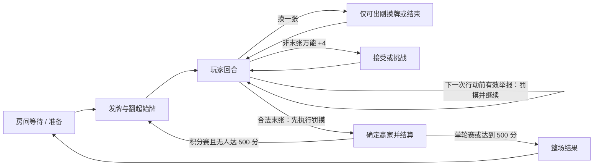

# Friemi UNO 在线游戏：规则与交互方案

> 更新：2026-10-12。用户确认按官方基础规则统一。新开局使用 v2；进行中的 v1 整场保留原规则，返厅再开局切换。
> 最新确认：两张变一张前点击 UNO，任意手牌数量均可手动点亮。漏喊后至下一位玩家出牌或摸牌前可举报；无效举报不罚牌。功能牌可收尾，末张 +2/+4 先罚摸再计分。没有提示、专门等待或全员确认。
> 目标：在 Friemi「桌游工具」中提供 2–10 人实时房间对局。参考「你画我猜」的房间体验与系统做法，UNO 规则单独实现。
> 规则基线：[Mattel UNO Card Game 说明书](https://service.mattel.com/instruction_sheets/UNO%20Basic%20IS.pdf)。以下“首版决定”是 Friemi 的产品选择；与实体牌说明书不同处均标明。

## 1. 首版范围

| 项目 | 已定规则与首版提案 |
| --- | --- |
| 人数与身份 | 2–10 位已登录 Friemi 用户；房主创建房间，房间号或邀请链接加入。开始后锁定参赛席位。 |
| 牌组 | 108 张基础牌：四色数字牌各 19 张、四色各 2 张「+2 / 反转 / 跳过」、万能牌与万能 +4 各 4 张。实体版说明书另有自定义万能牌；首版不启用。 |
| 发牌与目标 | 每轮每人 7 张；轮流出完手牌者获得其他玩家剩余牌面分。默认累计到 500 分结束整场；快速单轮中首位合法出完者立即结束整场，零分也成立。首轮随机庄家，后续轮次庄家顺座位轮换。 |
| 玩法 | 匹配当前颜色、数字或功能符号；万能牌可自由出。摸一张后只可出刚摸的牌，也可结束回合。允许主动选择摸牌。 |
| 功能牌 | +2 使下家摸 2 并跳过；跳过略过下家；反转改变方向，双人时等同跳过；万能牌出牌时选择颜色；万能 +4 触发挑战窗口。 |
| +4 挑战 | 出 +4 时可故意冒险。下家在 15 秒内选择接受或挑战；服务器以出牌瞬间的手牌校验是否有当前颜色。接受时下家摸 4 并跳过；挑战成功时出牌者摸 4、下家正常行动；挑战失败时下家摸 6 并跳过。服务器只公布裁决，不公开整手牌。 |
| UNO 宣告 | 两张变一张前主动点击 UNO，非本人回合也可点击。任意手牌数量均可点亮；手牌变化重置，唯独两张变一张保留宣告。漏喊不自动提醒或阻止收尾。 |
| 末张 | 所有合法数字、功能和万能牌都可收尾，仍须匹配，万能牌须选色。 |
| 牌堆耗尽 | 洗回弃牌堆除最上方一张之外的牌，延续当前颜色。洗牌在服务端执行。 |
| 本轮结束 | 末张 +2/+4 先使下家摸相应张数，再按剩余手牌计分并原子结算。末张 +4 没有其他手牌，必然合法，直接罚摸四张并结算。结束后不再举报或改判；数字按面值、功能牌 20、万能牌 50。 |
| 房规 | 首版关闭叠加 +2/+4、7-0 换牌、抢出、交换手牌和自定义牌。房间页明确展示规则摘要。 |

实体规则没有设备倒计时。为避免在线房间被离线玩家卡住，Friemi 首版建议每回合 60 秒，房主在开局前可选 30/60/90 秒；超时由服务端摸 1 张并结束回合，若正在 +4 挑战窗口则按“接受”处理。超时后抵达的命令一律拒绝。这个倒计时规则属于 Friemi 在线适配，不应写成 Mattel 官方规则。

开局翻到 +2、反转或跳过时按牌面效果决定首位行动者；翻到普通万能牌时由庄家左侧玩家选颜色后行动；翻到万能 +4 时洗回并重翻。双人反转立即让出牌者再行动。双人规则参考 [Mattel 两人 UNO 说明](https://service.mattel.com/instruction_sheets/41764-0920%20uno%20coca-cola.pdf)。

### 在线适配

房主在大厅选择单局 / 积分赛和回合时长，变更清除全员准备，开局后固定。+4 挑战由服务端裁决，不公开整手牌，15 秒无回应视为接受。开局锁定登录玩家；回合倒计时和超时代摸属于 Friemi 在线适配。

### 宣告与举报

1. 两张变一张前主动点击 UNO，任意牌数、任意人的回合均可点击；手牌未变时重复点击不重播。按钮不会随手牌数自动变色。
2. 没宣告就从两张变一张，立即可被举报。没有宽限等待或自动提醒；该动作保留刚产生的举报窗口。
3. 下一次成功出牌、摸牌或超时推进关闭此前窗口；+4 接受、挑战或自动接受同样关闭。UNO、表情、选牌、开局选色与无效请求不会关闭。
4. 目标仍剩一张、没宣告、窗口未结束，则罚目标摸二张，当前回合继续。无效举报只反馈操作者，不罚任何人。所有对手的举报入口始终一致。
5. 按服务端成功提交顺序裁决。补喊先成功则免罚；举报先成功则旧手牌版本的点击和出牌失效。举报绑定轮次与阶段，重试不重复罚牌。
6. 合法末张及末张罚摸、积分在同一事务完成，此后举报失效。双人跳过/反转允许同一玩家接着收尾；漏喊没被及时抓到仍可获胜。
7. 手牌增长或其他出牌清除宣告与旧窗口，再次两张变一张产生新阶段；旧举报不可复用。

## 2. 对局状态与命令

- 服务端状态至少记录：规则版本、座位与庄家、轮次、方向、当前玩家、回合 ID、牌堆顺序、弃牌堆、有效颜色、各人手牌与手牌版本、分数、截止时间、待处理罚摸/挑战、UNO 宣告、一张手牌阶段 ID、举报窗口是否开放、举报处理记录、最近动作摘要。牌用稳定唯一 ID 标识，同点数牌也不能混淆。举报资格及窗口状态仅在服务端保存，不向对手快照提供可举报布尔值。
- 命令建议为 `READY`、`START`、`PLAY_CARD`（万能牌同时提交颜色）、`DRAW_CARD`、`PLAY_DRAWN_CARD`、`PASS`、`ACCEPT_DRAW_FOUR`、`CHALLENGE_DRAW_FOUR`、`CALL_UNO`、`CATCH_UNO`、`REMATCH`、`RETURN_TO_LOBBY`。每个写命令有 `commandId`、整场/轮次/回合 ID，重试沿用原 ID。
- 摸牌后只允许刚摸的那张牌出在当前回合；已持有牌不可再出。出牌时服务器校验所有权、颜色/数字/符号、待处理罚摸、当前座位和截止时间；拒绝不会消耗回合或移走牌。+4 合法性以出牌前的手牌快照判断，不依赖客户端声明；末张 +4 必然合法，先罚摸再结算。
- `CALL_UNO` 绑定 `episodeId` 与 `handVersion`，任意手牌数量、非本人回合均可生效。客户端等待宣告回执后出牌，其他人不需确认；迟到点击不能替新手牌宣告。
- 成功出牌、摸牌或超时推进关闭此前已有的举报窗口；该动作新产生的窗口保留。+4 接受/挑战及自动接受同样关闭旧窗口。
- 举报使用轮次、一张手牌阶段 ID 和 `commandId` 校验，不采用固定秒数的窗口。所有对手的举报控件保持相同入口与样式；不公开 `canReport`、漏喊标记或举报窗口提示。属实举报原子执行一次罚摸；无效举报不罚牌。过期、网络重试和已处理请求不得再次处罚，未生效结果仅反馈操作者。
- 宣告、举报、出牌和结算均由服务端排序并原子提交。合法牌清空手牌的同一事务写入本轮结束、赢家和积分；后续举报无法改写结果。举报导致手牌变化后，旧手牌版本的出牌命令不自动重放，避免把玩家想提交的末张改为另一种出牌结果。
- 发牌或回合结算可重复调用但只写一次；房主手机断开或所有人离线也不影响服务端推进。

## 3. 页面与交互

### 入口与大厅

- 在现有「桌游工具」卡片列表加入 UNO。入口首屏直接展示“创建房间 / 房间号加入”，人数和经典规则摘要；支持中文、英文、法文。
- 大厅沿用画猜的轻快纸面、圆角厚底主按钮、明确焦点和状态反馈。座位区显示头像/昵称、房主、准备、空位；房主可设置回合时长并开局。邀请链接与房间号随手可复制。
- 开局条件为 2–10 位真人全部准备。房主退出或失联按既有房间接任模式处理。开局后离线者保留手牌与座位，返回时恢复；服务器按规则超时自动代摸、过牌。

### 对局桌面与手机

| 区域 | 手机 | 桌面 |
| --- | --- | --- |
| 顶部 | 返回/房间号、轮次、当前玩家、方向、倒计时的紧凑栏 | 同信息置于桌面上沿，留出稳定桌面空间 |
| 对手 | 小头像、剩余牌数、准备/掉线提示；不显示牌面 | 围绕牌桌分布，牌数和当前行动者明显 |
| 中心 | 摸牌堆、弃牌堆、当前颜色、最近动作和目标指引 | 更大的牌桌和动作回放，仍只保留一个主操作 |
| 我的手牌 | 屏幕下方横向可滚动扇形或单排；数字、颜色和符号并用 | 展开显示，键盘可逐牌聚焦 |
| 操作 | 上方固定三个按钮“不出 / UNO / 出牌”，位置与顺序始终一致。点牌先选中，再点出牌；万能牌先选颜色再提交。 | 同样保留三个固定按钮，支持键盘选牌与确认 |

- 仅自己的牌显示正面，其他座位只显示牌背和张数。可出的牌有轻微抬起与描边；不可出的牌保持清楚可读，但说明原因。不能只靠颜色辨认四种牌，给颜色配固定图形或文字标签。
- “不出”在未摸牌时摸 1 张；摸后若该牌不可出则自动结束回合，若可出则再次点“不出”结束回合，同一回合不能反复摸牌。UNO 按钮不随手牌张数自动变亮或闪动；任意手牌数量主动点击成功都高亮。成功宣告向全桌短暂展示一次“UNO！”，漏喊没有声音、文字或图标提醒。
- 仅剩功能牌可以正常打出；末张万能牌仍须选色，末张 +2/+4 罚摸计入结算。
- 点任意对手头像的常驻菜单可选择“举报漏喊 UNO”。所有对手的菜单入口和样式始终相同，不因有效举报机会而新增、高亮、闪动、显示角标或改变禁用状态。规则页说明该操作位置，对局中由玩家自己观察、记忆和判断；未成功的举报仅给举报者普通结果反馈。
- 末张出牌不增加举报等待、结算确认按钮或全员确认步骤，不以延长落牌动画来提供举报时间。常规动画不决定举报受理边界；服务端已接受合法末张时，即使其他设备仍播放动画，该轮举报也已失效。
- +4 只给受罚者显示“接受摸 4 / 挑战”决策层；其他人看到等待状态。挑战结果以短动画和文字解释罚摸归属，不展示整手牌。
- 断线时保留当前桌面并显示“正在重连”；恢复后先拉本人快照，再开放下一次操作。网络失败和命令过期都有可理解提示，不假装本地出牌已成功。
- 按画猜的移动端经验检查安全区、动态视口、短屏、横屏及底部导航遮挡。触控目标至少 44 px，输入/弹窗有键盘焦点，尊重减少动态效果设置。声音可开关。

### 结算与回房

- 每轮展示赢家、其他玩家剩牌计分、累计分和下一轮庄家。达到 500 分后展示整场排名、关键动作摘要与再来一局。
- 对局历史只向本场参赛者开放；记录赢家、各轮积分、参赛名单和规则版本。历史不泄露仍可能影响未来局的私密手牌或洗牌顺序。
- 玩家各自选择返回大厅；人数未齐时显示等待与进度。下一局准备状态重新清零。

## 4. Friemi 系统接入

- 新增独立 UNO 规则引擎及测试，不向 `drawGuessEngine.ts` 增加 UNO 分支。复用 Clerk → `UserProfile` 身份、房间号、座位/成员、邀请与已有游戏工具入口约定。接入点包括 `gameToolCatalog.ts`、`gameToolRooms.ts`、`GameToolKind`、本地化路由和 API。
- `GameToolRoom.state` 可保存首版规模的权威牌局 JSON；只允许服务端读取原始值。新增 UNO 截止时间索引、命令去重记录和只读轮次历史；避免复用 `drawGuessDeadlineAt` 或画猜作品表。后续若牌局记录扩大，再拆分存储。
- 写命令做身份、房间席位、回合与牌所有权校验；在数据库事务中用 `revision` 比较更新并记录 `commandId` 唯一结果。并发请求重试读取新状态；同一命令不会重复摸牌、计分或跳过。
- Realtime 只广播“房间版本更新”通知，客户端据此拉取**本人视角**快照；焦点恢复和低频轮询兜底。公开消息不能携带整副牌、任何手牌或牌堆顺序。服务端独立截止扫描推进超时回合与 +4 决策。
- 按开局时的 `rulesetVersion` 与设置快照裁决整场，后续修改默认值不影响正在进行的房间。

## 5. 实施与验收顺序

1. 按收尾方案完成纯规则引擎：108 张唯一牌、确定性可注入洗牌、初始牌效果、双人反转、摸牌限制、+4 挑战、UNO 宣告与举报截止裁决、弃牌洗回、合法牌收尾、原子结束与计分结算。用固定种子测试边界；罚摸数量与积分模式按最终产品取值设置。
2. 接入房间与服务端命令：并发 CAS、去重、身份与私密视图、截止扫描、断线/重连、历史。用多个独立身份验证不串手牌。
3. 实作入口、大厅、牌桌和结算的中英法界面；先做完整手机体验，再检查桌面和横屏。用浏览器截图查看 390 px 与 1280 px、短屏和触控区域。
4. 在隔离 Preview 用 2、4、10 人完成真实对局；覆盖重复/过期命令、+4 挑战、全部功能牌收尾、末张罚摸计分、任意牌数点击 UNO、两张变一张宣告、立即举报及下一次出牌/摸牌截止、并发提交、举报后旧手牌失效、断线恢复。举报入口不随资格改变样式，结束后不改判。

本方案可复用的画猜实现入口：`apps/web/features/game-tools/drawGuessRoomServer.ts`、`drawGuessEngine.ts`、`components/DrawGuessRoomClient.tsx`、`components/DrawGuessLobby.tsx`、`apps/web/app/globals.css`、`apps/web/prisma/schema.prisma`。最新代码优先于旧的双模式方案文档。个人 Codex skill 位于 `/home/ubuntu23/.codex/skills/friemi-table-games/SKILL.md`。
